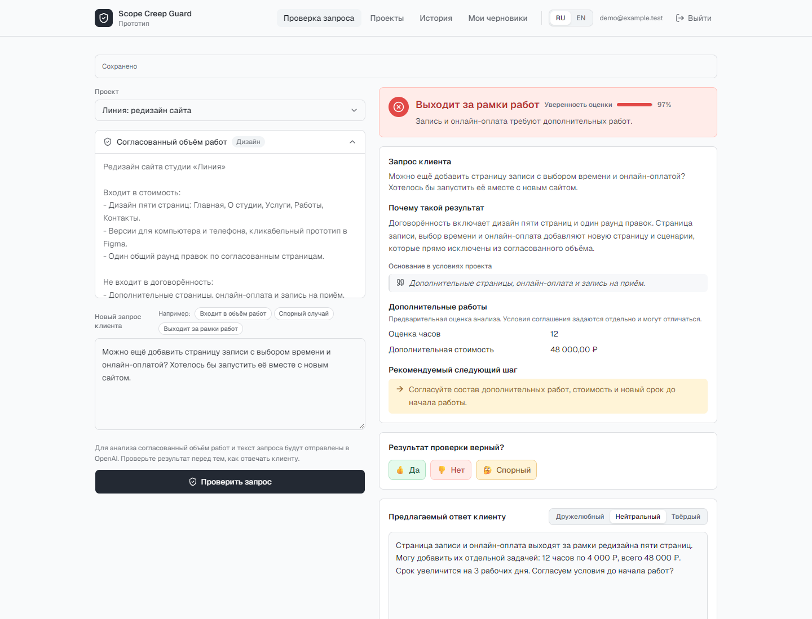
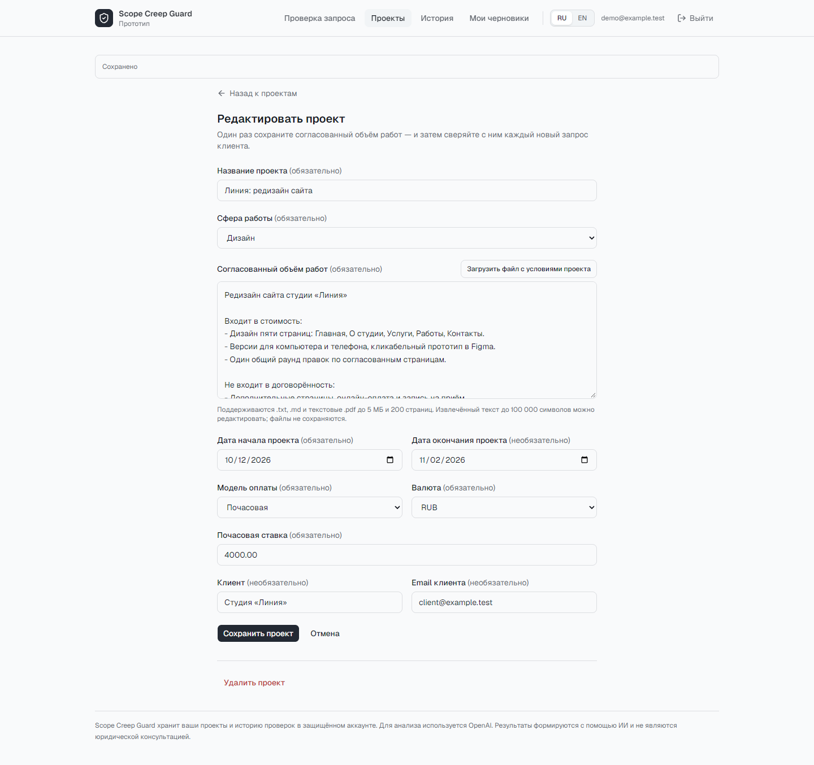
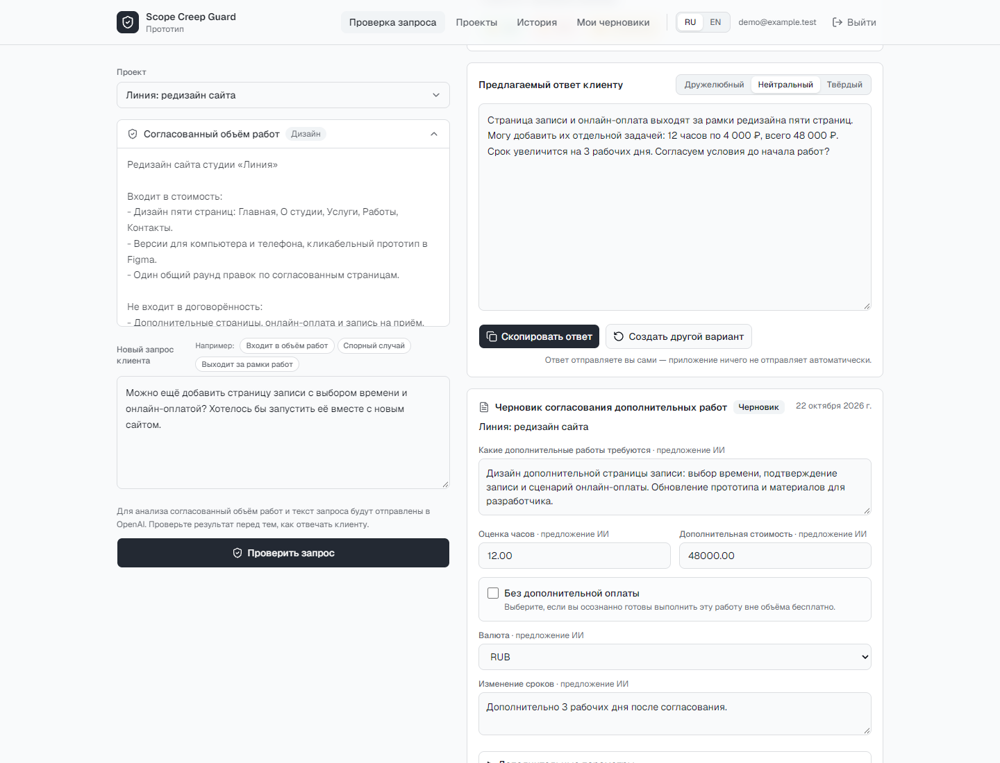
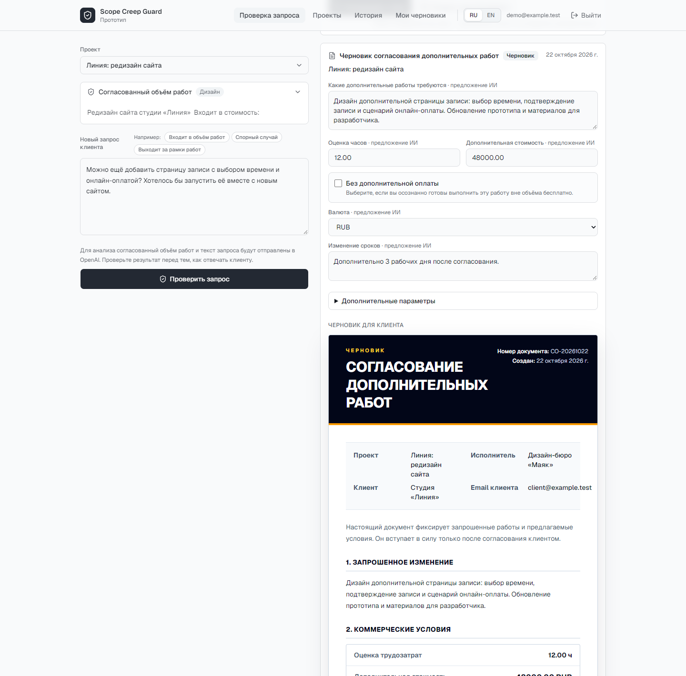
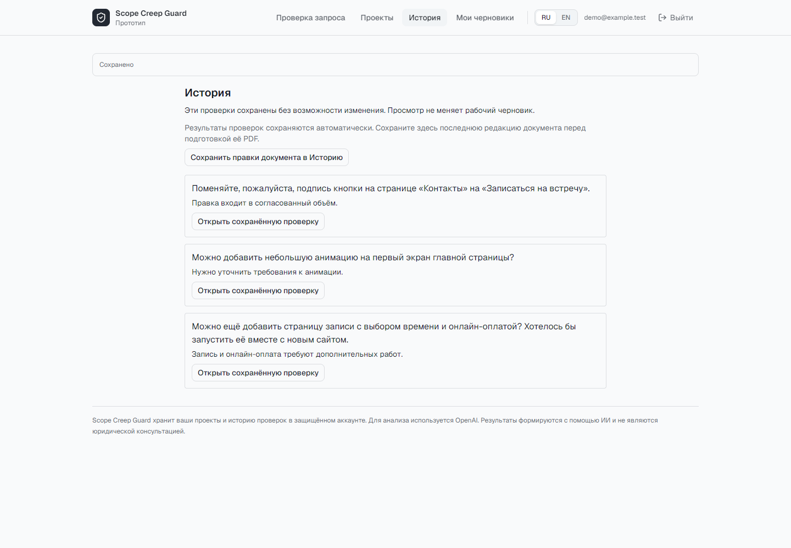
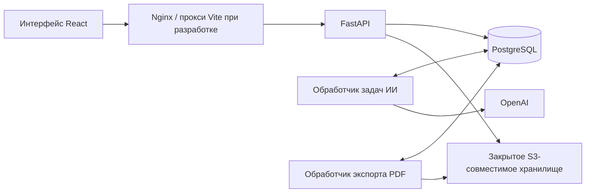

# Scope Creep Guard

**Проверяйте, входит ли новая просьба клиента в договорённость, и согласуйте допработы до их начала.**

Scope Creep Guard помогает фрилансерам и небольшим агентствам в разработке,
дизайне и маркетинге контролировать объём работ. Сохраните согласованные условия,
сравните с ними новый запрос клиента и подготовьте ответ или документ
с условиями дополнительных работ.



*Реальные снимки интерфейса с вымышленными проектами и заранее подготовленными
результатами анализа. Сумма 48 000 ₽ и показатель уверенности приведены для
примера. Скриншоты сделаны локально 22 октября 2026 года без платных вызовов модели.*

[Как это работает](#как-это-работает) · [Скриншоты](#скриншоты) ·
[Архитектура](#архитектура) · [Локальный запуск](#локальный-запуск) ·
[Разработка и проверки](#разработка-и-проверки)

## Как это работает

1. **Зафиксируйте договорённость.** Создайте проект: укажите результат работы,
   исключения, сроки, данные клиента и почасовую ставку или фиксированную цену.
   Вставьте условия текстом либо загрузите TXT, Markdown или PDF с текстовым слоем.
2. **Проверьте новую просьбу.** Вставьте сообщение клиента. Приложение объяснит
   результат, приведёт цитаты из условий и предложит следующий шаг. Для допработ
   может появиться предварительная оценка трудозатрат и стоимости.
3. **Подготовьте ответ.** Выберите дружелюбный, нейтральный или твёрдый тон,
   отредактируйте текст, создайте новый вариант или скопируйте ответ.
   Сообщение клиенту вы отправляете сами.
4. **Согласуйте допработы.** Подготовьте отдельный документ с описанием задачи,
   часами, ценой и изменением сроков. Проверьте и поправьте условия перед отправкой.
5. **Сохраните результат.** Продолжайте работу из раздела «Мои черновики»,
   возвращайтесь к завершённым проверкам в «Истории» и выгружайте итоговые
   документы в PDF.

| Результат | Что он означает |
| --- | --- |
| **Входит в объём работ** | Запрос входит в согласованный объём работ. |
| **Спорный случай** | В условиях есть неоднозначность; стоит уточнить её с клиентом. |
| **Выходит за рамки работ** | Запрос добавляет работу сверх договорённости. |

Проект находится на стадии рабочего прототипа. Анализ выполняет OpenAI,
результат проверяет человек. Приложение помогает подготовить решение и документ;
согласие клиента фиксируется вне приложения.

## Скриншоты

На всех экранах показан один пример: редизайн пяти страниц сайта студии «Линия».
После согласования клиент просит добавить страницу записи и онлайн-оплату.

### Условия проекта и стоимость работы

Карточка проекта хранит основу для будущих проверок: что входит в работу,
что исключено, кто заказчик и как рассчитывается стоимость.



### Ответ клиенту

Предложенный текст можно отредактировать, сменить тон и скопировать.
Оценка запроса и редактируемый ответ клиенту хранятся отдельно.



### Согласование дополнительных работ

Описание задачи, часы, сумма, валюта и изменение сроков редактируются рядом
с предпросмотром документа. Если вы решили выполнить допработы бесплатно,
можно явно указать это в условиях. Итоговые условия документа могут отличаться
от предварительной оценки анализа.



### История проверок

История хранит неизменяемые снимки завершённых проверок. Просмотр записи
сохраняет текущий рабочий черновик. Чтобы продолжить работу с прежним результатом,
его можно снова открыть в черновике.



Для выгрузки PDF сохраните последнюю редакцию документа в «Историю», откройте
соответствующую проверку, завершите документ и запустите экспорт. Готовый файл
можно скачать из этой записи. Завершение документа не подтверждает согласие клиента.

## Возможности

- **Личные аккаунты и проекты.** Вход по электронной почте и паролю, подписанные
  сеансовые cookie с флагом HttpOnly, доступ только к своим проектам, черновикам
  и истории.
- **Продолжение работы.** Автосохранение запросов и правок документа, история
  версий, обработка конфликтов и сообщения о восстановлении.
- **Раздельные языки.** Интерфейс на русском или английском. Язык ответов
  и документов для клиента определяется или выбирается отдельно.
- **Редактируемые документы.** Данные клиента и исполнителя, дополнительные
  условия, поля согласования, предпросмотр и фоновый экспорт PDF с хранением файла.
- **Обратная связь по анализу.** Отметки «Да», «Нет» и «Спорный»
  с выгрузкой своих оценок в JSONL.

Ограничения загрузки: **5 МиБ** на файл, **200 страниц PDF** и **100 000 кодовых
единиц UTF-16** извлечённого текста. Для PDF нужен текстовый слой; распознавания
сканов нет. Извлечённый текст можно редактировать, исходные файлы не сохраняются.
В проектах доступны рубли, доллары США и евро. Смена валюты не пересчитывает сумму.
При запуске анализа текст условий и запроса клиента отправляется в OpenAI.

## Архитектура

Пользовательский интерфейс работает как отдельное приложение React. Node.js
нужен для разработки и сборки; на сервере готовые статические файлы отдаёт Nginx.
Браузер обращается к `/api` на том же домене. FastAPI отвечает за аутентификацию,
бизнес-операции и доступ к базе данных.



| Слой | Технологии и ответственность |
| --- | --- |
| Интерфейс | React 19, TypeScript, Vite, React Router, Tailwind CSS, use-intl |
| API | Python 3.12, FastAPI, проверка входных данных и прав доступа |
| Предметная область и службы | Анализ запросов, работа с черновиками, согласование допработ и подготовка документов |
| Хранение данных | PostgreSQL 17, SQLAlchemy, миграции Alembic и очереди операций в базе |
| Генерация | OpenAI Responses API, LiteLLM и PydanticAI в обработчике задач ИИ |
| Документы | Формирование через ReportLab, фоновый экспорт и закрытое объектное хранилище |

```text
frontend/           Интерфейс React, ресурсы, тесты и образ Nginx
apps/api/           Сборка приложения FastAPI и контролируемый запуск контейнера
apps/worker/        Запуск обработчиков задач ИИ и экспорта PDF
backend/            Предметная область, службы, интеграции, хранение и миграции
contracts/          Данные для проверок совместимости
ci/                 Сценарии проверок и снимок контракта OpenAPI
tests/e2e/          Сквозные пользовательские сценарии
docs/               Описание продукта, интерфейса, архитектуры и результаты проверок
```

Границы модулей описаны в [распределении ответственности](docs/architecture/ownership.md),
фоновая обработка в [инструкции по обработчикам задач](apps/worker/README.md).

## Запуск через Docker

Нужны Docker Engine с Linux-контейнерами и **Docker Compose 2.24+** в режиме
Compose (не Swarm). Файл `deploy/compose.yaml` собирает единственные определения служб из
`deploy/compose/`; runtime-настройки API и обработчиков заданы явно в их
единственных определениях. Проверка конфигурации контролирует их согласованность.
[Механизм include](https://docs.docker.com/compose/how-tos/multiple-compose-files/include/)
позволяет выбирать службы без копирования определений. Межфайловый `extends`
не используется: Compose 2.24 и текущая версия разрешают его пути по-разному. Файлы запуска находятся
в существующем каталоге `deploy/`; include явно сохраняет корень репозитория
как базу контекстов сборки и локальных env-файлов.

### Настройка

Для новой локальной установки скопируйте `.env.example` в `.env` и задайте:

| Переменные | Назначение |
| --- | --- |
| `AUTH_SECRET` | Случайный секрет не короче 32 символов |
| `OPENAI_API_KEY`, `SCOPE_GUARD_OPENAI_MODEL` | Ключ и явно выбранная модель |
| `SCOPE_GUARD_LLM_INPUT_RATE_BOUND`, `SCOPE_GUARD_LLM_OUTPUT_RATE_BOUND` | Положительные консервативные цены в USD **за токен** |
| `SCOPE_GUARD_LLM_MAX_COST` | Лимит операции, по умолчанию USD 1 |
| `SCOPE_GUARD_DATABASE_URL` | Общая база API, мигратора и обработчиков; внутри Compose хост `postgres`, не `localhost` |
| `SCOPE_GUARD_EXPORT_BUCKET` | Существующий закрытый S3-совместимый бакет |
| `SCOPE_GUARD_EXPORT_ENDPOINT`, `SCOPE_GUARD_EXPORT_REGION` | Адрес совместимого сервиса и регион |
| `SCOPE_GUARD_EXPORT_ACCESS_KEY`, `SCOPE_GUARD_EXPORT_SECRET_KEY` | Доступ к бакету либо стандартная identity среды |
| `SCOPE_GUARD_ALLOWED_ORIGINS` | JSON-массив разрешённых адресов; измените при смене порта интерфейса |

Локальные PostgreSQL-реквизиты по умолчанию сохранены: `scopeguard`,
`scopeguard_dev_password`, база `scope_creep_guard`. При их изменении настройте
`POSTGRES_DB`, `POSTGRES_USER`, `POSTGRES_PASSWORD` и соответствующий URL вместе.
Изменение переменных PostgreSQL не меняет пароль в существующей базе.
`SCOPE_GUARD_PRODUCTION=false` подходит для локального HTTP; для HTTPS нужен `true`.

При подстановке Compose окружение оболочки имеет приоритет над явным `--env-file`
или корневым `.env`. Include-модели наследуют эту среду и используют стандартный
необязательный `.env` своего `project_directory`; относительных sentinel-путей нет.
Локальные серверные контейнеры дополнительно читают `.env`,
`.env.local`, `backend/.env` в этом порядке; явный блок `environment` службы
имеет приоритет над этими файлами. Обязательные подстановки берутся из окружения
Compose, а не из `env_file` службы. Для воспроизводимости используйте один явный
`--env-file`; Dokploy вообще не загружает локальные `env_file` контейнеров.
Значение `SCOPE_GUARD_MIGRATION_TARGET` больше не управляет выпуском.

### Полный стек и отдельные приложения

Команды выполняются из корня. Здесь `scopecreepguard` — имя **нового** проекта;
для существующей установки подставьте её прежнее имя во всех командах.

```sh
docker compose config --quiet
docker compose up -d --build
```

Откройте [интерфейс](http://localhost:3000). API доступен на порту 8000.
Полный стек включает PostgreSQL, мигратор, API, интерфейс, оба обработчика и Mailpit.
Объектное хранилище предоставляется отдельно. Запуск сам по себе не отправляет
платные задачи ИИ.

| Команда | Запускаемые службы |
| --- | --- |
| `docker compose --env-file .env -p scopecreepguard -f deploy/compose.postgres.yaml up -d --wait` | PostgreSQL |
| `docker compose --env-file .env -p scopecreepguard -f deploy/compose.backend.yaml up --build -d --wait` | PostgreSQL → migrate → backend |
| `docker compose --env-file .env -p scopecreepguard -f deploy/compose.frontend.yaml up --build -d --wait` | PostgreSQL → migrate → backend → app |
| `docker compose --env-file .env -p scopecreepguard -f deploy/compose.llm-worker.yaml up --build -d --wait` | PostgreSQL → migrate → llm-worker |
| `docker compose --env-file .env -p scopecreepguard -f deploy/compose.export-worker.yaml up --build -d --wait` | PostgreSQL → migrate → export-worker |

Компоненты используют те же имена служб, сеть и том, что полный стек с тем же
`-p`. Предупреждение об оставшихся службах при выборе компонента ожидаемо;
не добавляйте `--remove-orphans`. Компонентная проверка не доказывает готовность
всего приложения. PostgreSQL и migrate не требуют ключа провайдера.
API требует полный набор настроек. Обработчику ИИ нужны только база и настройки
провайдера/ценовых границ; обработчику экспорта — база и настройки хранилища.
Обработчикам не нужны `AUTH_SECRET` и настройки другой роли.

Для обычного запуска из корня файл выбирать не нужно. Не добавляйте
недокументированные `compose.override.yaml` к поддерживаемой конфигурации.
`deploy/docker-compose.yml` оставлен как совместимый вход полного стека. Прежние
`deploy/compose.workflow.yaml` и `deploy/compose.llm.yaml` удалены: их комбинации больше не нужны.

```sh
docker compose --env-file .env -p scopecreepguard -f deploy/compose.yaml ps --all
docker compose --env-file .env -p scopecreepguard -f deploy/compose.yaml logs --follow migrate backend app llm-worker export-worker email-worker
docker compose --env-file .env -p scopecreepguard -f deploy/compose.yaml down
```

`down` сохраняет том. Не используйте `down -v` или очистку томов для установки
с данными. В PowerShell дополнительно доступны `./scripts/dev.ps1 up`,
`up front`, `up back`, `up postgres`, `up llm_worker`, `up export_worker`,
`logs back`, `status`, `down` и `update`; параметр `-Project` задаёт прежнее имя.
Эта удобная оболочка требует Python 3 и не нужна для прямых команд Compose.

### Mailpit и единая точка запуска (ANY-778)

Из корня репозитория — `.env` загружается автоматически:

```powershell
docker compose up -d --build
```

Из существующего каталога `deploy/`:

```powershell
docker compose up -d --build
```

Корневой `compose.yaml` и `deploy/compose.yaml` подключают одни и те же
определения служб из `deploy/compose/`; проверка конфигурации контролирует их
равенство. На текущем Compose корневой `.env` загружается автоматически
из обоих каталогов.
На текущем Compose служебный `deploy/.env` содержит только `COMPOSE_FILE=../compose.yaml`: он
перенаправляет короткую команду на корневой вход, после чего Compose читает
корневой `.env`. Не записывайте в `deploy/.env` секреты или настройки приложения.
**Для минимального Compose 2.24.0** запуск из `deploy/` требует явного корневого
файла окружения: эта версия не перечитывает `.env` после изменения `COMPOSE_FILE`.
Минимальная поддерживаемая версия не повышается:

```powershell
docker compose --env-file ../.env up -d --build
```

Из корня короткая команда работает и на 2.24.0. Текущий Compose поддерживает
короткую команду из обоих каталогов.

Для явного выбора компонентного файла (`-f`) и тестового окружения используйте
`--env-file` при необходимости; параметры командной строки имеют приоритет.

Обе команды используют имя `scopecreepguard` по умолчанию — прежнее имя при
запуске из этого репозитория. `-p` имеет приоритет, затем `COMPOSE_PROJECT_NAME`
из окружения / явного env-файла. Для существующей установки всегда сохраняйте
её фактическое имя и проверяйте mount PostgreSQL перед запуском. Перемещение
файлов не переносит данные. Для тестов используйте `-p scg-test-UNIQUE`,
синтетический env-файл, отдельные образы и порты `0`, включая `MAILPIT_UI_PORT=0`.
Не удаляйте существующие тома.

Только Mailpit, без настроек приложения:

```powershell
docker compose -f deploy/compose.mailpit.yaml up -d
```

Компоненты `deploy/compose.{postgres,backend,frontend,llm-worker,export-worker}.yaml`
сохраняют ограниченный состав служб. `deploy/compose.mailpit.yaml` запускает
только Mailpit. `deploy/compose.services.yaml` и `deploy/docker-compose.yml` —
совместимые ссылки на полный стек; канонический файл — `deploy/compose.yaml`.
Определения служб находятся в `deploy/compose/`, а существующие `deploy/proxy/`
и `deploy/silo/` сохранены. Оболочки `scripts/stack.py` / `scripts/dev.ps1`
используют эти файлы и корневой `.env` по умолчанию; доступен компонент `mailpit`.

Mailpit закреплён на официальном `axllent/mailpit:v1.32.0` с проверенным
manifest digest `sha256:0790692be935ea4420d085694f7985b1f692ca6a8771ab0e0bd8ba75ac180498`.
Локальный UI: http://localhost:8025; `MAILPIT_UI_PORT` меняет только порт на
`127.0.0.1`. SMTP доступен контейнерам в общей сети как `mailpit:1025`, без
аутентификации и TLS; SMTP не опубликован на хост. API не зависит от готовности
Mailpit. Именованный том `<project>_scope_creep_guard_mailpit` хранит SQLite
`/data/mailpit.db`; лимит — 500 писем и 7 дней. Проверка готовности — `/mailpit readyz`.
SMTP relay / forwarding не настроены. Не публикуйте UI через внешний прокси.
Production-файл Dokploy намеренно не включает локальный Mailpit.

`no-reply-scopecreepguard@mail.com` — только отправитель технической локальной
проверки. Mailpit перехватывает письма, не доставляет их во внешние ящики.
Отправка писем приложением, подтверждение адреса и восстановление пароля сюда
не входят. Проверка инфраструктуры: `python scripts/verify_mailpit.py` (нужен Docker;
отдельный env-файл для Mailpit-only проверки не требуется).
Результаты сканирования, диагностика и устранение повреждения локального образа
Mailpit, а также успешные проверки SMTP и полного стека записаны в [отчёте ANY-778](docs/architecture/2026-10-29-any-778-deployment-verification.md).

### Миграции и диагностика

```text
PostgreSQL healthy → migrate successful → backend / llm-worker / export-worker / email-worker
backend healthy → app
```

Одноразовый `migrate` запускает существующий защищённый Alembic-инструментарий
из образа API. Цель — единственная head-ревизия миграций в образе выпуска;
сейчас это `0008_contextual_onboarding`. API и обработчики проверяют совместимость,
но не меняют схему. Обработчикам не нужен работающий API.

Транзакционная advisory-блокировка PostgreSQL удерживается тем же соединением
до проверки и commit. Ожидание ограничено 120 секундами; параметр
`SCOPE_GUARD_MIGRATION_LOCK_TIMEOUT_SECONDS` меняет этот срок. После получения
блокировки мигратор заново читает схему. Повторный запуск актуальной базы — no-op.
Ошибка возвращает ненулевой код и блокирует новые зависимые контейнеры.

Обычные `logs migrate` содержат execution ID, исходную и целевую ревизии,
ожидание/получение блокировки, отдельные ревизии, no-op, длительность и результат.
`migration_lock_timeout` означает другого держателя блокировки: проверьте его
журнал и активные процессы PostgreSQL. Не снимайте блокировку принудительно и
не запускайте второй инструмент изменения схемы. При завершении процесса его
соединение закрывается, транзакция откатывается и блокировка освобождается.
`schema_mismatch` требует проверки категории ошибки и базы оператором; секреты,
URL подключения и сырые SQL-параметры в журнал мигратора не выводятся.

Неизвестные ревизии, несовместимые схемы и понижение версии отклоняются.
Наличие старой базы не даёт разрешения на stamp/adoption. Для Drizzle нужны
явное `SCOPE_GUARD_ADOPT_LEGACY=true`, проверка происхождения и существующая
[поэтапная процедура expansion/backfill/check](docs/architecture/draft-workflow.md).
База с неперенесёнными данными может намеренно остановиться перед constraints;
автоматический мигратор не обходит этот барьер. После перехода уберите разрешение.

### Обновление существующей установки

Сначала сделайте и проверьте резервную копию. Сохраняйте прежнее имя Compose-проекта.
Проверьте фактический том, ничего не удаляя:

```sh
docker inspect --format '{{json .Mounts}}' EXISTING_POSTGRES_CONTAINER
docker volume inspect EXISTING_DATABASE_VOLUME
```

Стандартное имя тома остаётся `<project>_scope_creep_guard_postgres`, ключ тома —
`scope_creep_guard_postgres`. Смена `-p` создаёт другую базу: это не перенос данных.
Для нестандартного существующего тома задайте в выбранном env-файле:

```dotenv
SCOPE_GUARD_POSTGRES_VOLUME=EXISTING_DATABASE_VOLUME
SCOPE_GUARD_POSTGRES_VOLUME_EXTERNAL=true
```

`external=true` требует уже существующий том и не создаёт пустую замену при ошибке
имени. Применяйте эти значения во всех командах установки. Для стандартного
проектного тома оставьте оба параметра не заданными. До запуска проверьте
итоговый mount и имя тома через `config`; не публикуйте полный вывод, он может
содержать секреты. Не добавляйте произвольные overrides к include-конфигурации:
Compose 2.24 не поддерживает все варианты такого переопределения.

Обновление требует окна обслуживания. `depends_on` не останавливает старые
работающие контейнеры; обычного `up -d` для обновления недостаточно.
Подготовьте исходники выбранного выпуска и задайте `SOURCE_REVISION` равным
`git rev-parse HEAD` (в PowerShell: `$env:SOURCE_REVISION = git rev-parse HEAD`).
Зафиксируйте также локальные изменения и ID образов. Затем:

```sh
docker compose --env-file .env -p scopecreepguard -f deploy/compose.yaml config --quiet
docker compose --env-file .env -p scopecreepguard -f deploy/compose.yaml build
docker compose --env-file .env -p scopecreepguard -f deploy/compose.yaml stop app backend llm-worker export-worker email-worker
docker compose --env-file .env -p scopecreepguard -f deploy/compose.yaml up -d --no-build --wait postgres
docker compose --env-file .env -p scopecreepguard -f deploy/compose.yaml up --no-deps --no-build --force-recreate --abort-on-container-exit --exit-code-from migrate migrate
# Выполняйте следующие команды ТОЛЬКО если миграция завершилась с кодом 0:
docker compose --env-file .env -p scopecreepguard -f deploy/compose.yaml up -d --no-deps --no-build --force-recreate --wait backend llm-worker export-worker email-worker
docker compose --env-file .env -p scopecreepguard -f deploy/compose.yaml up -d --no-deps --no-build --force-recreate --wait app
```

В POSIX-скрипте используйте `set -e` либо соединение этапов через `&&`.
Если после остановки приложений любой этап завершается с ошибкой, остановите
все приложения перед исправлением и повтором:

```sh
docker compose --env-file .env -p scopecreepguard -f deploy/compose.yaml stop app backend llm-worker export-worker email-worker
```

`up --wait` работает в detached-режиме: ошибка готовности одной службы сама по себе
не останавливает успешно запущенных соседей. `set -e` или `&&` прерывают следующие
команды, но также не останавливают уже запущенные контейнеры. Оболочка ниже
автоматически выполняет эту очистку после ошибки этапа обслуживания:

`python scripts/stack.py update --project scopecreepguard` или
`./scripts/dev.ps1 update -Project scopecreepguard`.
Для опубликованных образов задайте все три `SCOPE_GUARD_*_IMAGE` неизменяемыми
release/digest-ссылками и используйте `--pull` (PowerShell `-Pull`); в прямой
последовательности замените `build` на `pull`.

Мигратор принудительно пересоздаётся для каждого обновления, даже если предыдущий
контейнер уже завершился успешно. При ошибке миграции или запуска API/обработчиков/
интерфейса оболочка останавливает все приложения.
PostgreSQL и данные сохраняются. Ошибка подготовки образов сохраняет старый стек
работающим. Если Docker не позволил остановить приложения, оболочка сообщает об
этом и сохраняет код исходной ошибки; оператор должен проверить и остановить
службы вручную. Исправьте причину, повторите последовательность.
Откат образа не понижает схему: восстановление несовместимой базы требует
проверенной резервной копии. Zero-downtime совместимость не заявляется.

### Dokploy / production

В Dokploy измените Compose Path с `docker-compose.dokploy.yml` на
`deploy/docker-compose.dokploy.yml` и сохраните прежнее имя проекта. Используйте этот файл в режиме Docker Compose с Git-источником,
сохраняющим файлы общего каталога. Укажите в Dokploy `POSTGRES_DB`, `POSTGRES_USER`,
`POSTGRES_PASSWORD`, соответствующий `DATABASE_URL`, `AUTH_SECRET`, ключ/модель/
ценовые границы, закрытый бакет и JSON `SCOPE_GUARD_ALLOWED_ORIGINS` с HTTPS-адресом.
Настройте домен на службу `app`, порт 3000. Локальные порты не публикуются,
локальные env-файлы контейнеров исключены, production принудительно включён.
Служба `app` объявлена прямо в файле запуска: Dokploy проверяет домены до
раскрытия `include`. Проверка конфигурации сравнивает её и весь production-стек
с общими определениями, включая `deploy/compose/app.production.yaml`.

Production-файл также запускает закреплённый образ PGSTY Silo и одноразовый
`silo-init`. Задайте отдельные `SCOPE_GUARD_SILO_ROOT_USER` и
`SCOPE_GUARD_SILO_ROOT_PASSWORD`, имя бакета и прикладные
`SCOPE_GUARD_EXPORT_ACCESS_KEY` / `SCOPE_GUARD_EXPORT_SECRET_KEY`.
Используйте `SCOPE_GUARD_EXPORT_ENDPOINT=http://silo:9000` и добавьте `silo` в
`NO_PROXY`. Инициализатор закрывает анонимный доступ и выдаёт приложению права
только на экспортные объекты выбранного бакета. Порты Silo и его консоли наружу
не публикуются; файлы сохраняются в томе `${COMPOSE_PROJECT_NAME}_scope_creep_guard_exports`.
API и обработчик экспорта ждут успешного завершения `silo-init`.
При прямом обновлении после остановки приложений и запуска PostgreSQL добавьте
`up -d --no-build --wait silo`, затем
`up --no-deps --no-build --force-recreate --abort-on-container-exit --exit-code-from silo-init silo-init`
перед мигратором. Оболочка `scripts/stack.py update --production` выполняет эти
шаги автоматически.

Для согласованной чистой установки вместо обновления задайте новое уникальное
`SCOPE_GUARD_POSTGRES_VOLUME` и `SCOPE_GUARD_POSTGRES_VOLUME_EXTERNAL=false`.
Это создаёт пустую базу, не копируя и не удаляя старый том; пользователи
регистрируются заново. Платный фоновый LLM-аудит отключён, локальная диагностика
по-прежнему выполняется после публикации результата.

Перед эксплуатацией оператор проверяет `docker compose version` на хосте
(нужна 2.24+) и выполняет `config --quiet` с production-файлом. Новый стек
использует тот же migration gate. Для обновления работающего стека отключите
параллельный auto-deploy и выполните последовательность обслуживания выше,
заменив имя проекта и файл на существующие Dokploy-значения. Доступна команда
`python scripts/stack.py update --production --project EXISTING_PROJECT --env-file DEPLOY_ENV`.
Обычная кнопка redeploy сама по себе не гарантирует остановку старых служб до DDL.
В этой работе развёртывание в рабочую среду не выполняется.
[Dokploy Compose](https://docs.dokploy.com/docs/core/docker-compose) описывает
Git-источники, переменные среды и пользовательскую команду запуска.

## Разработка и проверки

Для native-разработки нужны Node.js 22.13+, pnpm 10.34.1, Python 3.12 и uv
0.11.19. PostgreSQL можно запустить компонентной командой выше. Для подключения
с хоста замените `postgres` на `127.0.0.1` и опубликованный порт. Для native API
и обработчиков задайте `SCOPE_GUARD_WORKFLOW_V2=true` и
`SCOPE_GUARD_LLM_WORKFLOW=true` вместе с серверными настройками из таблицы выше. Перед запуском
API/обработчиков выполните явный миграционный этап; они не мигрируют сами:

```sh
cd backend
uv sync --locked --all-packages --all-groups --python 3.12
uv run python -m scope_guard.database.startup --database-url-env SCOPE_GUARD_DATABASE_URL
uv run uvicorn scope_guard_api.main:app --host 127.0.0.1 --port 8000 --reload --loop scope_guard.database.session:event_loop
```

Мигратор читает окружение процесса, а не `.env`. Для двух native-обработчиков
запустите `uv run python ../apps/worker/main.py`, задав роли `llm` и `exports`.
Для frontend настройте `frontend/.env.local`, затем выполните в `frontend/`
`corepack pnpm install --frozen-lockfile` и `corepack pnpm dev`.

Для проверки используйте **новое** имя проекта, свободные порты и отдельную базу;
не подставляйте URL приложения. Пример: `-p scg-test-UNIQUE` с `POSTGRES_PORT=0`,
`BACKEND_PORT=0`, `FRONTEND_PORT=0`. Подключение и секреты должны быть тестовыми.
Только полная композиция подтверждает запуск приложения целиком.

```sh
# Проверки из соответствующих каталогов:
# frontend/
corepack pnpm test
corepack pnpm lint
corepack pnpm typecheck
corepack pnpm api:types:check
corepack pnpm build
# backend/
uv run pytest --require-integration
uv run ruff check . ../apps/api ../apps/worker
uv run ruff format --check . ../apps/api ../apps/worker
uv run mypy src/scope_guard ../apps/api/src/scope_guard_api
uv run python scripts/export_openapi.py --check ../ci/contracts/openapi.json
# Из корня: CI проверяет реальные образы и точный Compose startup.
bash ci/scripts/check-containers.sh
bash ci/scripts/smoke-compose.sh
```

CI использует синтетический ключ без отправки задач, отдельный S3 fixture,
уникальные проекты и только принадлежащие тесту тома. Для изоляции переменные
`SCOPE_GUARD_LOCAL_ENV_FILE`, `SCOPE_GUARD_LOCAL_OVERRIDE_ENV_FILE` и
`SCOPE_GUARD_BACKEND_ENV_FILE` указывают на пустой тестовый файл вместо `.env`,
`.env.local` и `backend/.env`. Определения служб, цель миграции и зависимости
при этом не переопределяются. Подробные команды, версии и фактически выполненные
проверки фиксируются в [отчёте запуска](docs/architecture/2026-10-24-docker-startup-verification.md).

## Документация

- [Оглавление документации](docs/README.md)
- [Требования к продукту](docs/product/scope-creep-guard-prd.md)
- [Работа с проектами и черновиками](docs/design/project-draft-ai-workflow.md)
- [Включение режима с сохранением состояния операций](docs/architecture/draft-workflow.md)
- [Отчёт о переходе интерфейса на React](docs/architecture/plans/2026-10-19-react-frontend-migration.md)
- [Неблокирующая генерация](docs/architecture/2026-10-17-nonblocking-llm-workflow.md)
- [Планы реализации и правила передачи работы](docs/architecture/plans/README.md)

В описаниях продукта и интерфейса есть исторические предложения. Текущее поведение
определяется исходным кодом приложения и результатами проверок соответствующих версий.

## Backend email (ANY-779)

`EmailService` prepares confirmation and password recovery messages in Russian or
English, with text/HTML alternatives and a 24-hour validity statement. Callers
supply the recipient, action URL and explicit `ru` or `en` locale. Unsupported
locales fail. The service neither creates tokens nor changes accounts.

Future auth services can obtain `email_service(request)` through the existing API
wiring, then await `send_confirmation(recipient, action_url, locale)` or
`send_password_recovery(...)`. `prepare(kind, recipient, action_url, locale)` and
`send(message)` allow keeping the same Message-ID for correlation. That identifier
provides no exactly-once guarantee. Callers must construct trusted-origin action
URLs and enforce the actual 24-hour token expiry in later auth work.

Settings use the `SCOPE_GUARD_` prefix:

| Setting suffix | Default | Meaning |
| --- | --- | --- |
| SMTP_HOST | mailpit | SMTP server |
| SMTP_PORT | 1025 | Port, 1–65535 |
| SMTP_SENDER_ADDRESS | no-reply-scopecreepguard@mail.com | Local test identity |
| SMTP_SENDER_NAME | ScopeCreepGuard | Optional display name |
| SMTP_TRANSPORT | none | Explicit `none`, required `starttls`, or implicit `tls` |
| SMTP_USERNAME / SMTP_PASSWORD | absent | Optional pair, supplied via backend env files |
| SMTP_TIMEOUT | 10 | Per-operation seconds, >0 and ≤120 |
| SMTP_DEADLINE | 30 | Overall seconds, >0 and ≤300 |

Credentials are checked on use, so unused email does not require SMTP credentials
or connectivity at startup. Certificate verification stays enabled. Mailpit uses
explicit plaintext SMTP internally and remains local capture only; its UI is at
[localhost:8025](http://localhost:8025). No SMTP host port, relay or readiness
dependency is added. Real local secrets must not be committed.

Success means SMTP acceptance, not confirmed inbox delivery or a read receipt.
`EmailError.category` is `invalid` (configuration/message), `temporary`
(connection/4xx), `authentication`, `rejected` (permanent SMTP rejection), or
`ambiguous` (timeout/disconnection, possibly already accepted). There are no
automatic retries inside the adapter. Password recovery uses the bounded
PostgreSQL email-worker retry policy described below; confirmation stays on its
existing delivery path.
Logs contain only correlation ID, kind, locale, duration and safe outcome category.
No protocol debugging is enabled. Provider response text is never exposed.

The adapter uses [aiosmtplib's documented SMTP API](https://aiosmtplib.readthedocs.io/en/stable/reference.html),
with explicit TLS flags, native awaits and immediate transport close after the
transaction to avoid an unbounded QUIT exchange.

Verification from repository root (the project name must be unique for every run):

```powershell
uv run --package scope-guard pytest backend/tests/unit/test_email.py -q
uv run --package scope-guard ruff check backend/src/scope_guard/services/email backend/src/scope_guard/integrations/email backend/tests/unit/test_email.py backend/tests/integration/email_mailpit_check.py
uv run --package scope-guard mypy backend/src/scope_guard apps/api/src/scope_guard_api
$env:MAILPIT_UI_PORT='18079'
docker compose -p any779-smtp-20261029 -f deploy/compose.mailpit.yaml up -d
docker build -f apps/api/Dockerfile --target checks --label org.opencontainers.image.revision=9da7aa54d5b4961d664b6c4ef591cee7cbe7f6d9 -t any779-email-checks:20261029 .
docker run --rm --network any779-smtp-20261029_default --mount "type=bind,source=$((Get-Location).Path)/backend/tests/integration/email_mailpit_check.py,target=/check.py,readonly" any779-email-checks:20261029 python /check.py
docker image inspect any779-email-checks:20261029 --format '{{.Id}} {{json .Config.Labels}}'
docker compose -p any779-smtp-20261029 -f deploy/compose.mailpit.yaml stop
```

This bounded check sends four trusted synthetic messages, reads them through the
Mailpit API and checks both templates/locales. It does not establish full-stack
E2E readiness. Keep disposable volumes unless removal is explicitly authorized.

### Password recovery (ANY-782)

The RU/EN sign-in screen links to `/forgot-password`. The public
`POST /api/auth/password/request` accepts `{email, locale}` and returns the same
neutral `202 {"ok":true}` for existing/unknown addresses and address suppression.
It commits PostgreSQL accounting and a delivery job before responding; account
lookup and SMTP happen only in the dedicated email process. A `503` means the
request could not be durably accepted. Source/global limits return `429` with
`Retry-After`, independently of account existence.

Email links use trusted `SCOPE_GUARD_PUBLIC_APP_URL` and a fragment token;
production requires HTTPS. GET/preview does not consume the link. Explicit
`POST /api/auth/password/reset` accepts `{userId, token, password, locale}`.
Reset atomically changes the password, consumes/revokes reset tokens, revokes
sessions and saves a password-change notification job. It does not confirm email
or sign the user in. Projects, drafts, history and ownership remain unchanged.

The email process shares the API image and database. Its authoritative definition
is `deploy/compose/email-worker.yaml`, with component entrypoint
`deploy/compose.email-worker.yaml`; root/deploy startup includes it. API and worker
require migration `0011_password_recovery` through the existing one-shot gate.
Neither changes schemas on startup. Include `email-worker` in maintenance stops
and post-migration restarts; `scripts/stack.py update` does this automatically.
SMTP uses existing settings; production Compose also forwards optional
`SCOPE_GUARD_SMTP_USERNAME`/`SCOPE_GUARD_SMTP_PASSWORD` from the selected environment.
Mailpit readiness is not a dependency.
The email-worker healthcheck observes its live loop and PostgreSQL heartbeat;
SMTP availability is excluded. This also supports `up --wait` on Compose 2.24.

Default admission limits: address cooldown 60s and 3/hour, source 10/minute and
60/hour, global 100/minute and 1000/hour. Reset attempts: source 30/15 minutes,
global 300/minute. Unknown addresses count too. The immediate network peer is the
source; forwarded-IP headers are ignored. Clients behind a common proxy/NAT share
the source limit. Do not enable Uvicorn proxy headers without a separate reviewed
trusted-proxy design. PostgreSQL windows and HMAC keys are bounded to 50,000
records; no arbitrary new keys are inserted after global rejection.

Queue caps are 10,000 recovery jobs and a separate 1,000 notification jobs,
including completed rows pending cleanup. At notification capacity, reset returns
`503` and rolls back. Claims use `SKIP LOCKED`, a 120s lease and ownership fencing.
SMTP has a 30s worker deadline and no open transaction. Temporary/ambiguous
failures have at most five attempts, with 1/5/15/60 minute delays plus 0–10s jitter.
SMTP acceptance is not inbox delivery. A crash after acceptance can duplicate
email; retries replace only that job's preceding token. Only the latest attempt's
link remains valid. No exactly-once delivery is claimed.

Recovery jobs expire 24h after admission; issued tokens have the existing 24h TTL.
Pre-reset jobs cannot mint post-reset links. An already prepared email can arrive
late with an invalid token. Cleanup runs in batches of 500: terminal jobs after
seven days, obsolete limit windows after 24h, expired reset tokens after seven
days. Worker outage cannot exceed queue/key caps, but can cause `429`/`503` once
capacity is exhausted. Notification delivery failure never reverses a committed
password change. Monitor safe `email_job_result`/infrastructure events and failed
jobs; no body, token, password or SMTP credentials are logged.

Focused verification, from repository root after building API/frontend images
tagged `scope-guard-api:any782` and `scope-guard-frontend:any782`:

```powershell
.venv/Scripts/python.exe backend/scripts/verify_password_recovery.py start
.venv/Scripts/python.exe backend/scripts/verify_password_recovery.py check
.venv/Scripts/python.exe backend/scripts/benchmark_password_recovery.py
.venv/Scripts/python.exe backend/scripts/verify_password_recovery.py stop
```

This harness owns a unique Compose project, synthetic environment and private
test storage. It combines the frontend, email-worker and Mailpit component
entrypoints; it never starts `llm-worker`, makes LLM calls or removes volumes.
State/evidence live under ignored `output/any782`. Keep the ownership record for
later cleanup; `start` refuses to overwrite it. Timing calibration expires only
this contour's synthetic limit windows between batches, outside measured HTTP
requests. It is not a production administration tool. The result proves the
password-recovery journey, not application-wide readiness or external delivery.

Security rationale follows [OWASP Forgot Password guidance](https://cheatsheetseries.owasp.org/cheatsheets/Forgot_Password_Cheat_Sheet.html)
and the email-code lifetime and notification guidance in
[NIST account recovery](https://pages.nist.gov/800-63-4/sp800-63b/events/#account-recovery).
The queue is this application's architectural choice. Full NIST conformance is
not claimed; email-only recovery cannot protect a compromised mailbox.
