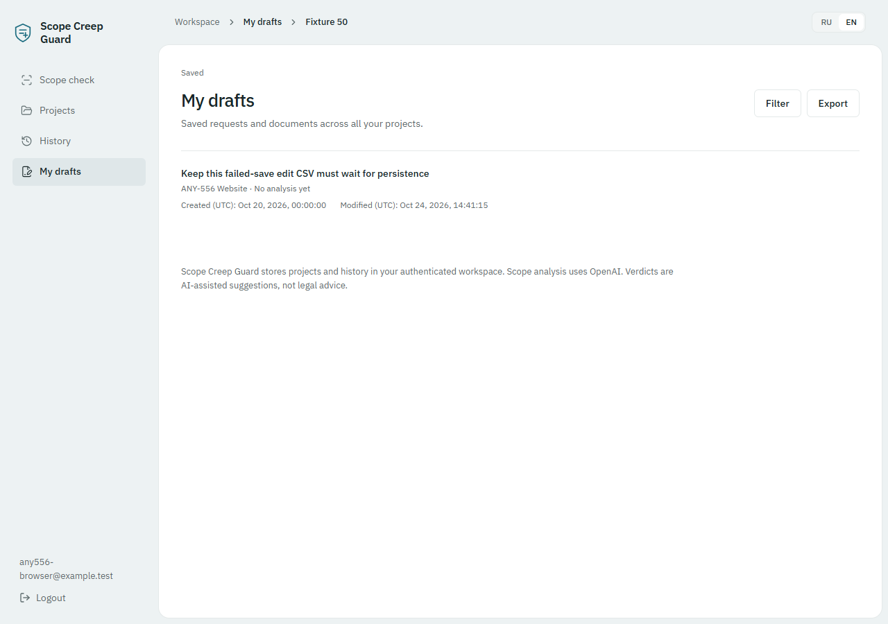
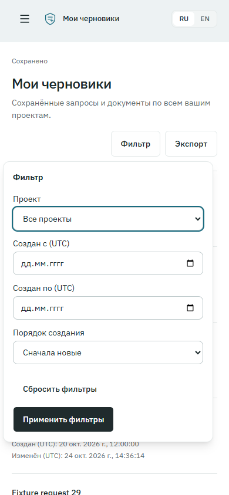

# ANY-556 Draft CSV verification

The approved Draft interpretation of ANY-556 is implemented and verified. Its
historical History wording does not describe this change. CSV exports read
current Drafts; they do not create History, finalize agreements, call AI, or
change business state.

## Source and isolation

- Exact fetched main base: `43b0f4bcc3605b571caefa843706a4b752b46560`.
- Tested application revision: `bc56573f3a5e17c14f8c7e9f2661249c53df0dda`.
- Branch: `codex/any-556-draft-filters-csv`; PR target: `main`.
- Infrastructure [PR #42](https://github.com/gushinets/ScopeCreepGuard/pull/42)
  was already merged into the exact base. No unmerged infrastructure dependency.
- Implementation used the native isolated checkout. The original
  `codex/predictable-docker-startup` checkout stayed on
  `1d73574f373b63a5bbeb8635fa16f32d8ff7aebb`; its three untracked acceptance
  report/plan/evidence paths remain unchanged.
- During acceptance, local uncommitted files were documentation and browser
  acceptance scripts only. Application source and generated contracts matched
  the tested revision. The exact status is in the evidence manifest. Subsequent
  delivery commits add documentation/evidence and acceptance scripts only.
- No Linear descriptions/statuses, merge, deployment, existing databases, or
  existing volumes were changed. Private worklogs remain ignored and retained.

## Results

| Check | Result |
| --- | --- |
| Full backend, including PostgreSQL integrations | **1,000 passed** in 561.58 seconds |
| Full frontend | **398 passed**, 53 files |
| Focused backend collection/CSV/workflow checks | **44 passed**; overlaps full suite |
| Backend unit/API/architecture subset | **851 passed**, 149 integration cases deselected; overlaps full suite |
| Ruff / format check | Passed; 390 files formatted consistently |
| Mypy | Passed; 232 source files |
| OpenAPI and generated frontend type freshness | Passed |
| Frontend types, lint, dependency boundaries | Passed; 104 modules |
| Production frontend build | Passed; existing >500 kB chunk advisory remains |
| Full supported Compose stack | Migrator exit 0; PostgreSQL, API, frontend and both workers healthy |
| Private object storage | Anonymous bucket GET returned 403 |
| Real browser | Desktop EN, 390×844 RU, downloads, filters, focus, failure/retry passed |
| Mechanical UI inspection | No findings (`[]`) |

Commands were run from the corresponding README directories:

```text
backend/:
uv run pytest --require-integration --basetemp=../.superpowers/sdd/2026-10-24-any-556-draft-filters-csv/pytest-full-stable -o faulthandler_timeout=90 -q
uv run ruff check . ../apps/api ../apps/worker
uv run ruff format --check . ../apps/api ../apps/worker
uv run mypy src/scope_guard ../apps/api/src/scope_guard_api
uv run python scripts/export_openapi.py --check ../ci/contracts/openapi.json

frontend/:
corepack pnpm test
corepack pnpm typecheck
corepack pnpm lint
corepack pnpm api:types:check
corepack pnpm build
```

Generation used `backend/scripts/export_openapi.py --output` followed by
`corepack pnpm api:types`; generated types were not hand-edited. Check outputs and
exit codes are retained in [static checks](evidence/2026-10-24-any-556/static-checks.json),
[backend output](evidence/2026-10-24-any-556/backend-full.txt), and
[frontend output](evidence/2026-10-24-any-556/frontend-full.txt).

## Docker evidence

Docker Engine **29.8.2**, Compose **5.6.0**. Unique project:
`scg-any556-test-3f4517d449ab4abab293a9c79340a8ce`.

The runner used empty test environment files, synthetic provider/auth/storage
settings, a private MinIO fixture, and the repository's `compose.postgres.yaml`
then `compose.yaml`. No feature overlays or migration-target overrides were used.
The one-shot migration gate reached `0008_contextual_onboarding` before API and
workers started. No paid AI jobs were submitted.

Fresh images all carry revision label
`bc56573f3a5e17c14f8c7e9f2661249c53df0dda`:

| Image | Image ID |
| --- | --- |
| `scope-guard-api:any556` | `sha256:f69af051ffca956261cbe50eef8fb1f5c4b6a0b176a79109c2acb114815be26c` |
| `scope-guard-worker:any556` | `sha256:320789a5ac554fdf9ae256262ade04b5d7d0aa6c55d47ab2dc48c6fad566401c` |
| `scope-guard-frontend:any556` | `sha256:d090ab2dd2858186af65cbc5f6f0faa45d2e4d30715d342a37bac54df29dbd3e` |

Running container image IDs were compared to these fresh image IDs. Migrator/API
share the API image; both workers share the worker image. The
[manifest](evidence/2026-10-24-any-556/manifest.json) records container IDs, health,
image IDs, revision labels, and local source changes. Test services were stopped
after acceptance; the database volume and worktree were retained.

## Browser and CSV acceptance

Two editable projects were created through the browser. Controlled fixtures added
enough current Drafts for 53 owned active rows, one archived project, foreign
projects, UTC midnight boundaries, and equal creation timestamps. Analysis fields
came from the repository's deterministic local fixture, not a provider call.

- Immediate individual export before analysis persisted the edited multiline
  request, then downloaded confirmed revision **2**.
- Collection page 1 showed 50 rows; page 2 showed 3. Export downloaded all **53**.
- Oldest/newest order, equal-timestamp ID ordering, project filter, date range,
  combined filters and reset were checked. The inclusive single-day range had
  **51** matches; the specific-project range had **1**; an empty range exported
  headers only.
- Applied filters survived opening a Draft and returning. Unit regression also
  proves Apply/Clear/paging retain unrelated query, fragment and history state.
- RU and EN exports had the expected BOM, delimiter and 18 columns. Browser
  downloads were compared with PostgreSQL IDs, order and confirmed revisions.
  The earlier single export retains its captured revision 2; a later ordinary
  edit intentionally advanced the same Draft to revision 3.
- Current edited reply, formula prefix, multiline Unicode/quotes, hours `2.50`,
  amount `999999999999.67`, currency and explicit free-work boolean were checked.
  Unit serialization tests additionally cover larger exact decimal strings and
  Unicode whitespace/control prefixes.
- A browser-injected definitive save failure kept edits and produced **zero CSV
  requests and zero downloads**. Existing Retry persisted the edit, and the next
  export downloaded confirmed revision **3**.
- Tab/Shift+Tab stayed in the export dialog; Escape and successful completion
  restored trigger focus. A reversed date range showed an error and focused the
  ending date. The filter popover also restored focus on Escape.
- RU at 390×844 had no horizontal overflow. Projects still showed 53 active owned
  rows, excluded the foreign/archived project, and History navigation remained
  available. Server integration tests cover immutable state and owner isolation.
- The PostgreSQL integration snapshots **every public table** around export reads
  and confirms unchanged rows, revisions, timestamps, activity/session data and
  metrics. Autosave is tested separately as an ordinary write.

[Browser results](evidence/2026-10-24-any-556/browser-checks.json) and
[CSV audit](evidence/2026-10-24-any-556/csv-audit.json) contain the assertions.
Reusable browser journeys are in `tests/e2e/any556-browser.js` and
`tests/e2e/any556-save-failure.js`, executed with Playwright CLI `run-code
--filename`. They require the controlled disposable fixture described above.





## Migration decision and query measurements

No Alembic migration is needed. Existing `created_at`/`updated_at` `timestamptz`
columns, the one-Draft-per-project constraint, and existing indexes are reused.
There is no timestamp backfill or schema mutation at startup.

The actual shared repository query was explained against the disposable data,
with 5,000 additional synthetic Drafts belonging to another owner. The planner
used `projects_owner_listing` for the tested owner-scoped reads. Measured
execution times were 4.334 ms (newest), 3.410 ms (oldest), 2.195 ms (project/date),
and 3.575 ms (owner/date). No missing index was demonstrated.

A complete synthetic export of **5,003** foreign-fixture Drafts produced
**964,753 bytes** in **0.5277 seconds**, including an EXPLAIN measurement pass.
This is a fixture measurement, not a capacity guarantee. Plans and buffer data
are in [query-plans.json](evidence/2026-10-24-any-556/query-plans.json).

## Review, resolved failures, and limits

Independent review found one important defect: filter/page navigation discarded
the URL fragment/history state. Its regression failed before the fix and passed
after the shared navigation helper was added. The full 398-test frontend suite
then passed. No critical issues or deferred minor findings remained.

Failed attempts are not counted as passes:

- Initial native runs could not access the shared Windows `pytest-of-jackd`
  temporary directory. This affected the future-head migration fixture and six
  unit fixtures (two OpenAPI export cases and four technical-operation cases).
  Fresh per-run temporary directories resolved them; the final full suite passed.
- Docker returned EOF during parallel image export and a 502 on initial stack
  startup. Serial fresh builds and retrying the same disposable Compose project
  succeeded. Earlier full-suite runs held stale PostgreSQL fixture connections
  after the Docker restart and were interrupted. The final run used a fresh
  fixture and passed all 1,000 tests.
- Controlled fixture setup needed the existing Windows selector event-loop
  policy and an amount within the existing document limit. No validation rule
  was relaxed. A browser automation label lookup was changed to the observed
  accessible combobox role before the successful acceptance run.
- Local Vercel analytics script loading returns an existing 404; unauthenticated
  startup returns the expected auth/me 401. Neither indicates a CSV failure.

Collection listing and later export are separate current-state reads; concurrent
changes may shift offset pages. CSV currently materializes rows in memory.
Commercial text remains in its saved language, and formula protection deliberately
prefixes hazardous text cells. The exact contract and limitations are documented
in [Draft filtering and CSV](../design/draft-filtering-csv.md).
