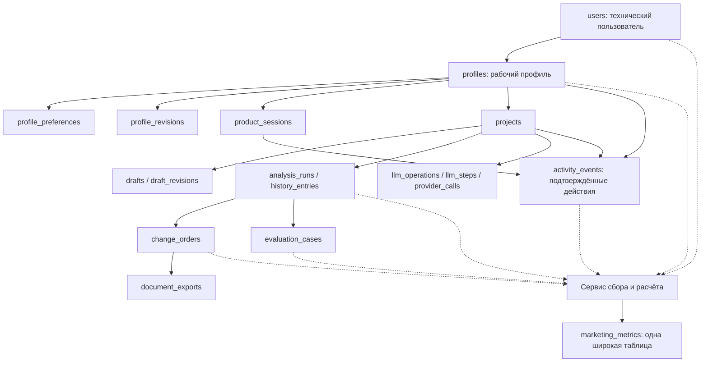

# Profile, поведение пользователя и единая таблица метрик

Дата: 16 октября 2026 года, Europe/Moscow.

Статус: согласованный в диалоге дизайн с явно указанными открытыми решениями.
Документ описывает целевое устройство; наличие описания не означает реализацию.
Изменений приложения, миграций и рабочей БД при его подготовке не выполнялось.

## 1. Цель и границы

Разделить техническую учётную запись и рабочий профиль пользователя, сохранить
значимые действия и предоставить маркетологам одну широкую таблицу
`marketing_metrics` с рассчитанными показателями. Маркетологам не нужно
самостоятельно соединять внутренние таблицы или рассчитывать KPI через SQL.
Пользовательский интерфейс администрирования и система экспорта сейчас не нужны.

Используем только данные пользователей и их действий в приложении. Внешние CRM,
платежи, маркетинговые расходы, сторонние источники и обогащение профиля исключены.
Текст запроса, scope, переписка, email, пароли и токены не копируются в итоговые
метрики. В исходных рабочих сущностях данные остаются по их существующим правилам.

Пользователь согласовал расчёт итоговой таблицы. Это развитие более раннего
минимального требования Михаила о достаточности сохранённых исходных данных;
данный документ не является подтверждением расширения scope самим Михаилом.

## 2. Согласованные правила

| Область | Правило |
|---|---|
| Активность | Успешный сохранённый базовый анализ запроса ИЛИ оформление CO |
| Не активность | Вход, просмотр страниц, автосохранение, перевод, регенерация и PDF сами по себе не создают активного пользователя |
| Активация | Первая успешная проверка с сохранённым результатом в течение 7 дней после регистрации |
| Первая ценность | Первая успешная сохранённая проверка; TTV отсчитывается от регистрации |
| PQL | Не менее 3 успешных проверок и хотя бы одно оформление CO за последние 30 дней |
| Периоды | Одна итоговая строка на день, UTC; MAU — 30 дней |
| Adoption | Доля дневной активной аудитории, успешно использовавшей функцию в тот же день |
| Retention | Возврат к значимому действию на 7-й/30-й календарный UTC-день после активации |
| Операции | Проверка, регенерация, перевод и обновление оценки; отдельно по типам и общим итогом |
| Длительность | От принятия задания сервером до терминального исхода, включая очередь и повторы |
| PDF | Не входит в основные операции, DAU, активацию или PQL |
| Обновление | После завершённых действий; сверка временных окон при чтении/выгрузке |
| Качество | Тестовые/внутренние профили исключаются; неизвестное — NULL; текущий день предварительный |

Наличие CO не является условием активности или активации. Пользователь только
анализа — полноценный активный пользователь. CO нужен дополнительно только для PQL.
Оформление CO означает существующее подтверждённое сервером действие финализации,
а не открытие редактора, автогенерацию текста или принятие документа заказчиком.

## 3. Одна БД, несколько исходных таблиц, одна итоговая таблица

Используется текущий PostgreSQL и SQLAlchemy с Alembic. Не создавать вторую
копию `users`, проектов, событий или учёта ИИ. Отдельный metrics worker не вводится.
Сервис расчёта имеет собственный модуль, репозитории и UoW, но может исполняться
в существующем backend-процессе. Его транзакция отделена от бизнес-транзакции.

Стрелки схемы показывают предметные связи и чтение источников, а не исчерпывающий
список FK. Допуск LLM/PDF-данных в итоговую таблицу пока открыт, см. раздел 10.

### Сохранить и улучшить существующее

`users`, `projects`, `drafts`, `draft_revisions`, `analysis_runs`,
`history_entries`, `change_orders`, `document_exports`, `evaluation_cases`,
`llm_operations`, `llm_steps`, `provider_calls`, `activity_events`.

Сначала привести SQLAlchemy mappings к фактической целевой Alembic-схеме.
Не использовать старые compatibility ORM-классы как описание всех новых таблиц.
SQLAlchemy ORM/Core и специализированный SQL допустимы; обязательны актуальные
контракты, ограничения и отсутствие устаревших полей в активном пути.

### Добавить вокруг профиля

| Таблица | Основные колонки | Ограничения |
|---|---|---|
| `profiles` | `id UUID`, `user_id UUID`, display/business/provider name, profession, status, revision, created/updated_at | PK id; FK user_id; UNIQUE user_id; revision > 0 |
| `profile_preferences` | `profile_id`, locale, timezone, preferred_tone, default_currency, revision, updated_at | PK/FK profile_id; проверка допустимых значений |
| `profile_revisions` | id, profile_id, revision, snapshot JSONB, actor_user_id, operation_id, created_at | UNIQUE(profile_id, revision); ключ идемпотентности изменения |
| `product_sessions` | id, profile_id, started_at, last_activity_at, ended_at, rule_version | FK profile_id; временная согласованность |
| `marketing_metrics` | Дата, готовые показатели, качество и свежесть | PK report_date |

`users` остаётся корнем аутентификации. `profiles.user_id` связывает рабочий
аватар с технической записью. Сейчас один профиль на пользователя. Предпочтения
задаются пользователем; автоматические психологические/профессиональные выводы,
trait/evidence-таблицы и AI-профилирование в этот объём не входят.

`projects.profile_id` вводится с backfill из существующего `projects.user_id`.
Во время перехода проверить соответствие владельцев; не менять UUID проектов,
истории и результатов. Остальные рабочие сущности получают профиль через проект,
если отдельное поле не требуется для доказанного запроса/целостности.

Продуктовая сессия отлична от auth-сессии. Правило inactivity и несколько вкладок
нужно определить до использования её длительности; Session Duration не добавляется
в обязательный текущий набор KPI автоматически.

## 4. Единый сбор подтверждённых событий

Расширить `activity_events`, выделить самостоятельный EventRepository и сервис
подготовки типизированных событий. Переиспользовать текущие FK на draft, revision,
analysis, history, CO и export. Новые поля добавлять аддитивно:

- `profile_id`: рабочий субъект; на этапе регистрации может отсутствовать до
  создания профиля в той же транзакции;
- nullable `project_id`: регистрация/профиль/посещение не требуют проекта;
- `actor_user_id`, `actor_type`, `source`: отличать инициатора от системы-исполнителя;
- `product_session_id`, nullable;
- `occurred_at` и `recorded_at`, оба TIMESTAMPTZ;
- `operation_id`, `event_type`, существующая версия payload;
- стабильный deduplication key в scope источника;
- типизированный ограниченный payload, без полных пользовательских текстов.

Не удалять старые события и их ссылки. Существующий immutable trigger учитывать
при backfill: миграция должна иметь явно проверенный порядок работы с ограничениями,
не отключать защиту в runtime. Для новых событий использовать явную версию контракта.

Старое UNIQUE(project_id, operation_id, event_type) недостаточно для событий без
проекта и нескольких попыток ИИ. Новый ключ различает логические события и попытки.
Повтор ключа с другим содержимым — конфликт, а не молчаливое ON CONFLICT DO NOTHING.

Минимальные события: profile.created/updated, project.created/updated,
draft.updated/restored, check.requested/completed/failed, reply.regenerated,
translation.completed/failed, estimate.completed/failed, evaluation.changed,
change_order.finalized/voided. События просмотра и клика не подменяют успешное
серверное действие. LLM accounting не дублируется в JSON событий.

## 5. Итоговая таблица marketing_metrics

Таблица предназначена для последующего экспорта без JOIN со стороны маркетологов.
Никаких metric_definitions, metric_runs, EAV-значений и отдельных агрегатных таблиц
на этом этапе. Определения версионируются в коде/документации.

### Служебные колонки

| Колонка | Тип | Значение |
|---|---|---|
| report_date | DATE PK | Отчётная UTC-дата |
| calculated_at | TIMESTAMPTZ | Когда рассчитана строка |
| data_through | TIMESTAMPTZ | Фактическая граница включённых данных |
| definition_version | INTEGER | Версия правил расчёта |
| is_partial | BOOLEAN | Текущий день/неполные исходные данные |
| quality_notes | JSONB | Типизированные коды неполноты, без пользовательских текстов |

### Продуктовые колонки

| Колонки | Тип | Расчёт |
|---|---|---|
| registered_profiles, new_profiles | BIGINT | Всего зарегистрированных на границе / новые за день |
| dau | BIGINT | DISTINCT profile_id со значимым действием за день |
| mau | BIGINT | DISTINCT profile_id за 30 календарных UTC-дней, включая отчётный |
| stickiness_percent | NUMERIC(9,4) | 100 × dau / mau |
| activation_eligible_profiles, activated_profiles | BIGINT | Созревшая регистрационная база и активировавшиеся за первые 7 дней |
| activation_rate_percent | NUMERIC(9,4) | 100 × activated / eligible |
| ttv_sample_size | BIGINT | Профили с известной первой ценностью на границе |
| time_to_value_median_seconds | NUMERIC(20,3) | Медиана(first_saved_check_at − registered_at) |
| pql_profiles | BIGINT | DISTINCT профили: ≥3 успешных checks и ≥1 CO за 30 дней |
| retention_d7_base, retention_d7_returned | BIGINT | Когорта активации report_date−7 и вернувшиеся в отчётный день |
| retention_d7_percent | NUMERIC(9,4) | 100 × returned / base; незавершённый день NULL |
| retention_d30_base, retention_d30_returned | BIGINT | Аналогично для report_date−30 |
| retention_d30_percent | NUMERIC(9,4) | Аналогично D7 |
| analysis_users, regeneration_users, translation_users, change_order_users | BIGINT | DISTINCT профили из DAU, успешно использовавшие функцию за день |
| analysis_adoption_percent, regeneration_adoption_percent, translation_adoption_percent, change_order_adoption_percent | NUMERIC(9,4) | 100 × соответствующий users / dau |

Созревшая база активации на data_through: только пользователи, для которых полностью
прошло 7 суток после регистрации. Это предлагаемое точное уточнение знаменателя,
подлежащее подтверждению перед реализацией. Поздняя первая проверка даёт TTV, но
не считается активацией в семидневном окне. COUNT DISTINCT по user/profile совпадает
только при действующем ограничении один профиль на пользователя.

### Операционные колонки

Для каждого префикса `check`, `regeneration`, `translation`, `estimate`:

- `{prefix}_started`, `{prefix}_succeeded`, `{prefix}_failed`, `{prefix}_cancelled` — BIGINT;
- `{prefix}_success_percent` — NUMERIC(9,4);
- `{prefix}_duration_sample_size` — BIGINT;
- `{prefix}_duration_median_ms`, `{prefix}_duration_p95_ms` — NUMERIC(20,3).

Общие колонки: `operations_succeeded/failed/cancelled`, `operation_success_percent`,
`operation_duration_sample_size`, `operation_duration_median_ms`,
`operation_duration_p95_ms`. Входят только четыре перечисленных типа, без PDF.
Starts относятся к дате принятия, исходы/длительности — к дате завершения.
Success = succeeded / (succeeded + failed + cancelled); отмена не является
ошибкой провайдера, но не считается успешным завершением. В расчёт не входят
ожидающие операции. Это точное правило знаменателя фиксируется в реализации.

`checks_started/succeeded/failed` из прежнего обсуждения соответствуют колонкам
`check_*`; не создавать второй набор с другим смыслом. Новая сознательная проверка
с тем же текстом учитывается отдельно; сетевой повтор одной операции — нет.

### Документы и обратная связь

| Колонки | Тип | Значение |
|---|---|---|
| change_orders_created, change_orders_voided | BIGINT | Фактическое оформление/аннулирование за день |
| verdict_correct, verdict_wrong, verdict_debatable | BIGINT | Текущее распределение оценок проверок, завершённых в отчётный день |
| verdict_evaluated_checks, verdict_feedback_percent | BIGINT / NUMERIC(9,4) | Количество оценённых checks и доля среди успешных checks дня |

Изменение оценки пересчитывает строку даты соответствующей проверки, а не создаёт
ещё один голос. Передача CO не означает его принятие/оплату; эти показатели отсутствуют.

### Условные колонки — не включать без разрешения открытого вопроса

Ранее заявленные технические показатели: `ai_calls`, `ai_retries`,
`input_tokens`, `output_tokens`, `cached_tokens`, `reasoning_tokens`,
`ai_estimated_cost_usd`, `ai_cost_unknown_calls`, `ai_usage_unknown_calls`,
`validation_accepted`, `validation_rejected`, `validation_rejection_percent`.
Источники уже существуют; требование «только пользовательские данные» пока не
уточняет, допускается ли связанный технический учёт ИИ в маркетинговую таблицу.

Аналогично PDF: он исключён из основных операций, но включение отдельного
`pdf_export_success_percent` и счётчиков экспорта пока не подтверждено.
Не выдавать эти колонки за согласованные или реально измеренные.

## 6. Транзакционный путь

### T1: действие пользователя

1. API аутентифицирует пользователя, на сервере разрешает profile_id и владение.
2. Валидирует команду, revision и идемпотентность.
3. В одном UoW сохраняет предметное изменение, необходимую ревизию и событие.
4. COMMIT подтверждает выполненное действие. Репозитории самостоятельно не commit-ят.
5. Сервис расчёта вызывается только после успешной фиксации T1.

Для ИИ запуск и завершение — разные действия. HTTP 202 не означает успешный check.
Check становится успешным для активности только после сохранения принятого полного
результата. Сохранённый поздний результат applied=false остаётся успешным check,
но не должен перезаписать новый Draft.

### T2: обновление marketing_metrics

1. Открыть новый UoW, прочитать только зафиксированные источники.
2. Пересчитать затронутые даты по фактам, вместо слепого увеличения счётчиков.
3. Сохранить строки и границу учтённых данных атомарно.
4. COMMIT завершает T2.

Ошибка T2 не откатывает уже успешное действие T1 и не превращает его в ложную
ошибку для пользователя. Следующее завершённое действие либо чтение/выгрузка
выполняет сверку и восстанавливает значения. Не полагаться на fire-and-forget задачи
в памяти или HTTP-уведомление как единственный источник восстановления.

Без периодического обработчика актуальность при полном отсутствии обращений
не гарантируется: строка хранит data_through/calculated_at, а чтение/выгрузка
актуализирует окна. Это согласованное ограничение текущего решения без воркера.

Пересчёт одной даты сериализуется до чтения исходных данных, например транзакционной
блокировкой по report_date. При нескольких датах — одинаковый порядок блокировок.
Использовать согласованный snapshot чтения; старый расчёт не может перезаписать
новый. Позднее событие влияет на свой день и соответствующие окна MAU/retention.
Определить это явно, не использовать MAX(id) как доказательство commit-порядка.

Регистрация создаёт user и profile с событием атомарно. Тестовые/внутренние профили
имеют явный серверный признак исключения из аналитики. Удаление/исправление
источников запускает повторную сверку затронутых периодов по согласованной политике.

## 7. Разделение ответственности

- domain: неизменяемые события, профиль, значения и правила показателей;
- services: use cases профиля, сбор событий, расчёт таблицы, границы T1/T2;
- database: актуальные mappings, специализированные repositories/read queries;
- UoW: создание/завершение транзакции; отдельный экземпляр для T1 и T2;
- API: идентификация, контракт, ошибки; не вычисляет KPI в обработчиках;
- Alembic: только новые аддитивные миграции и проверяемый backfill.

Одна SQLAlchemy AsyncSession не разделяется между конкурентными задачами.
Внешние LLM/HTTP вызовы не выполняются внутри открытой бизнес-транзакции.

## 8. Обязательные правила тестирования

### Пользовательский путь

| Сценарий | Проверка БД и результата |
|---|---|
| Регистрация и вход | Созданы user/profile; вход сам по себе не увеличивает DAU/MAU |
| Пользователь только смотрит страницу | Нет значимого действия и искусственной активации |
| Первая успешная проверка | Результат/History и событие зафиксированы; T2 даёт DAU=1, MAU=1, корректный TTV |
| Только анализ без CO | Пользователь активен; активация возможна; отсутствие CO не блокирует продукт |
| Только CO в следующий день | Значимое действие в этот день; DISTINCT не удваивает одного человека |
| Повтор команды после потери ответа | Та же операция/History/событие; метрики не растут повторно |
| Новая проверка с тем же текстом | Новая операция увеличивает checks; DAU остаётся 1 |
| Ошибка проверки | failed увеличивается; не создаёт успешный check, первую ценность или DAU самостоятельно |
| Перевод/регенерация без анализа или CO в день | Не создаёт DAU; учитывается в операционных исходах |
| Adoption | Числитель — подмножество DAU, проценты не превышают 100 |
| PQL | Только анализы, только CO, 2 анализа+CO не проходят; 3 анализа+CO в окне проходят |
| Изменение оценки вердикта | Старый вклад заменяется; один check не даёт два голоса |
| PDF | Не меняет основную активность/операционную успешность |

### Границы времени и определений

- Фиксированные часы в тестах, UTC и полуоткрытые интервалы [start, end).
- Проверки до/после полуночи, истечение окна 30 дней без новых действий.
- Первая ценность раньше, точно на границе и позже 7 суток; семантика границы
  определяется единообразно в коде и тестах.
- Незрелая база активации/retention, отсутствие знаменателя и выборки: NULL, не 0.
- D7/D30: возврат именно на целевой календарный день, а не в любое время до него.
- Средние/медианы/P95 рассчитываются по наблюдениям; не усреднять дневные медианы.
- Backfill не придумывает сессии/события, которых исторически не записывали;
  неполное покрытие явно отражено в качестве данных.

### Транзакции, конкуренция и восстановление

- Искусственная ошибка до COMMIT T1: нет изменения, ревизии, успешного события
  и увеличения метрики.
- Ошибка T2 после COMMIT T1: действие сохранено, пользователь не теряет результат;
  следующая сверка восстанавливает таблицу без повторного LLM-вызова.
- Перезапуск между T1 и T2: то же восстановление по PostgreSQL.
- Две одновременные команды одного профиля и команды разных профилей:
  нет потерянных обновлений, двойного DAU или перезаписи свежего расчёта старым.
- Позднее завершение, applied=false, перенос через полночь и завершение после reload.
- Повтор полного пересчёта одного snapshot даёт идентичные показатели.
- Чужой профиль/проект отклоняется; profile_id не принимается на доверии от клиента.
- Тестовые и внутренние профили исключены из всех числителей и знаменателей.

### Уровни доказательств

1. Unit: формулы, ограничения, контракты событий и граничные даты.
2. Integration: настоящий одноразовый PostgreSQL, миграции/backfill, T1/T2,
   rollback, конкуренция и дедупликация; никаких application DB.
3. API: реальная аутентификация/владение, команда, ответ и независимое чтение БД.
4. Browser: пользователь входит через login, выполняет действие, перезагружает
   страницу; проверяется сохранённое состояние и строка marketing_metrics.
   Админку для проверки не создавать — тестовый инструмент читает БД самостоятельно.

Минимальный основной journey повторить три раза на независимых профилях/данных.
Дополнительно повторить одну команду три раза с одним ключом и три раза с разными
ключами. Зафиксировать ожидаемые/фактические строки, версии приложения и правил.
Controlled provider допустим для проверки сбора данных; не объявлять его доказательством
качества настоящей модели. Незавершённый/заблокированный тест не считать PASS.

## 9. Порядок внедрения

1. Инвентаризация текущей схемы, mappings и точек записи; сохранить существующее.
2. Аддитивные profile-таблицы и проверенный backfill владельцев.
3. Общий репозиторий событий, контракты и покрытие действий в T1.
4. Одна marketing_metrics и сервис пересчёта в T2; без универсальной платформы KPI.
5. Интеграционные/пользовательские проверки, документирование качества и свежести.

## 10. Открытые решения — не подменять предположениями

1. Включать ли связанную техническую телеметрию ИИ в маркетинговую таблицу после
   требования «только пользовательские данные»? До ответа ledger остаётся как есть.
2. Нужна ли отдельная бонусная метрика PDF, несмотря на исключение PDF из основных
   операций? Пока её колонки условны.
3. Подтвердить точные знаменатели активации/операционной успешности, правило
   продуктовой сессии и политику удаления данных. Предложенные правила выше
   являются конкретизацией для реализации, а не новыми ответами пользователя.

Эти вопросы не мешают проектированию user/profile и надёжной записи событий.
Они должны быть закрыты до реализации соответствующих расчётов.

## 11. Явные уточнения пользователя — 16 октября 2026

Открытые вопросы раздела 10 разрешены пользователем при начале реализации;
исходное обсуждение выше сохранено как история решений.

1. В `marketing_metrics` включаются связанные с пользовательскими операциями
   вызовы ИИ, повторы, токены, оценочная стоимость и результаты валидации,
   включая условные AI-колонки раздела 5. Существующий ledger остаётся источником
   истины; технический учёт не дублируется в событиях. PDF-колонки в итоговую
   таблицу не входят. Существующие учёт ИИ и PDF-функциональность сохраняются.
2. Знаменатель активации — профили, у которых полностью истекли семь суток
   после регистрации; числитель берётся из этой же созревшей базы. Окно
   активации полуоткрыто: `[registered_at, registered_at + 7 суток)`;
   проверка точно на правой границе не активирует профиль, но даёт TTV.
3. Успешность операций — `100 × succeeded / (succeeded + failed + cancelled)`.
   Ожидающие операции и PDF не входят; нулевой знаменатель даёт NULL.
4. Продуктовая сессия истекает после 30 минут без пользовательской активности.
   Вкладки одного аутентифицированного пользователя в одном браузере разделяют
   сессию; другие браузеры/устройства имеют отдельные сессии. Фоновые опросы
   и автоматические запросы не продлевают активность. Сессии не меняют срок
   аутентификации и правила DAU/MAU. Session Duration не добавляется к KPI.
5. Существующее поведение удаления сохраняется. Новые правила удаления или
   анонимизации не вводятся; связанные ограничения аналитики документируются.
6. Вызов ИИ, его итоговые usage/cost/validation относятся к исходной UTC-дате
   начала физического вызова. Поздние данные обновляют строку этой исходной даты.
   Retry — физическая попытка с `semantic_attempt > 1 OR transport_attempt > 1`;
   каждая попытка считается один раз, даже если выполнены оба условия.
   Обычные этапы и первичные reviewer-вызовы не являются retry. Неполные суммы
   токенов/стоимости дают NULL с явными счётчиками неизвестных вызовов.
   Неразрешённые резервы стоимости не входят в `ai_estimated_cost_usd`.
