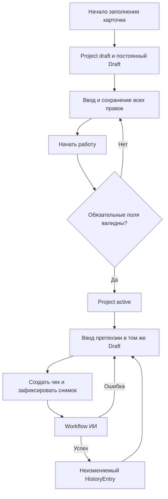
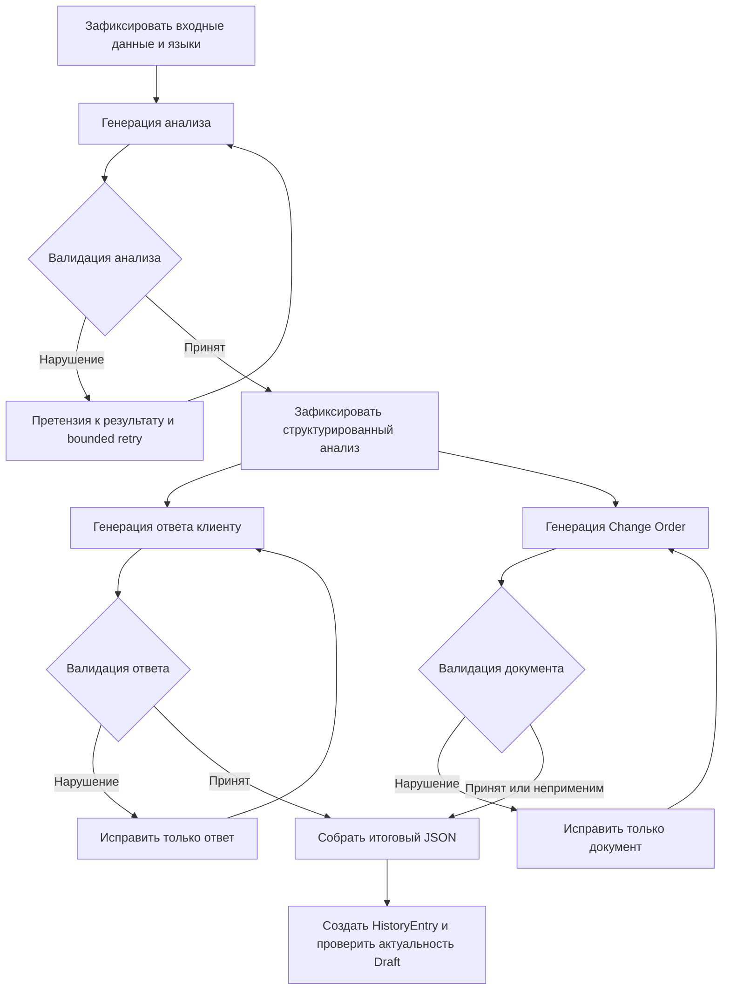

# Старый дизайн проектов, черновиков, истории и workflow ИИ в ScopeCreepGuard

Дата: 13 октября 2026 года.

Статус: старый дизайн, редакция 1. Восстановлен из первой редакции документа, сохранённой в истории обсуждения. Заменён [обновлённым дизайном](project-draft-ai-workflow.md). Сохранён для сравнения; не использовать как актуальное руководство реализации.

Эта версия предшествует корректировкам по требованиям заказчика: отдельным редакциям материалов конкретного чека, переводу для проверки смысла и экспорту без обязательной финализации.

## 1. Назначение

ScopeCreepGuard помогает исполнителю сравнить претензию или пожелание заказчика с согласованным scope проекта, получить объяснение результата, подготовить ответ заказчику и Change Order. Сервис сохраняет работу пользователя, позволяет вернуться к незавершённому проекту и хранит каждый успешно созданный чек как самостоятельный исторический результат.

В основе дизайна — PostgreSQL как источник истины, один постоянный Draft на проект, полный журнал изменений и независимые проверки по новым обращениям. Работа ИИ разделена на проверяемые этапы с отдельными языковыми контрактами. Каждый вызов провайдера учитывается для контроля стоимости, ошибок и повторов.

## 2. Согласованные продуктовые правила

1. Незавершённая карточка проекта сохраняется в PostgreSQL.
2. У проекта ровно один постоянный рабочий Draft. Его UUID сохраняется на протяжении жизни проекта.
3. В интерфейсе существует одна вкладка «Мои черновики», одна строка на проект. Незавершённые карточки и рабочие проекты не разделяются по вкладкам.
4. Все пользовательские данные, включая необязательные поля и промежуточные правки, сохраняются в PostgreSQL. Прежнее правило хранения необязательных полей только в браузере заменяется этим решением.
5. Каждая принятая правка создаёт неизменяемую ревизию. История изменений не ограничивается финальным текстом.
6. Заполнение обязательных полей само по себе не активирует проект. Переход происходит при начале работы над проектом после серверной валидации.
7. У активного проекта нельзя сохранить изменение, которое делает обязательные поля невалидными.
8. «Создать чек» всегда запускает новую независимую проверку ИИ по актуальной претензии и условиям проекта.
9. У одного проекта может быть много чеков. Идемпотентность относится к конкретной команде создания чека.
10. HistoryEntry появляется после успешного завершения обязательных этапов команды «Создать чек». Отдельная кнопка сохранения результата в историю не нужна.
11. Ручные правки, автосохранения, выход со страницы и неуспешная генерация не создают HistoryEntry.
12. После создания чека Draft сохраняется. Для следующего обращения пользователь меняет текст в том же окне; отдельной кнопки «Новое обращение» нет.
13. Изменение претензии или условий анализа делает старые результаты неактуальными. Изменение названия проекта или данных клиента не сбрасывает анализ.
14. Удалённый проект доступен семь дней для просмотра и восстановления. После срока worker окончательно удаляет его данные и файлы.

## 3. Пользовательский workflow

### 3.1. Создание и начало работы

При первом содержательном вводе backend создаёт проект в статусе `draft` и его единственный Draft одной транзакцией. Сетевой повтор не создаёт второй проект. Пустое открытие формы не обязано создавать пустую запись.

Пользователь заполняет карточку и может уйти в любой момент. При возвращении сервис загружает подтверждённое серверное состояние. Незаполненные обязательные поля разрешены в незавершённом проекте.

При действии «Начать работу над проектом» backend проверяет обязательные поля согласно условиям проекта. При ошибке переход блокируется; интерфейс указывает конкретные поля. При успехе проект становится `active`, фиксируется событие `project.started` и открывается то же рабочее пространство.

Обязательность зависит от карточки и модели оплаты: например, для почасовой модели нужна положительная ставка, для fixed fee — положительная стоимость проекта. Email клиента и дата окончания необязательны; дата начала и валюта обязательны для начала работы. Полный набор обязательных полей должен использовать единый серверный контракт с соответствующими сообщениями RU/EN.

### 3.2. Работа с претензией

Пользователь вводит обращение заказчика в постоянное поле Draft. Каждая правка отправляется в API и сохраняется как новая ревизия. В интерфейсе подтверждение «сохранено» появляется только после успешного commit.

После изменения текста прежние анализ, ответ и Change Order скрываются как устаревшие и недоступны для экспорта из текущего рабочего состояния. Они остаются в ревизиях и ранее созданной истории.

Изменение scope, индустрии или коммерческих условий тоже инвалидирует результат. Название проекта и данные клиента обновляют оформление рабочего документа без новой оценки scope. Языковые изменения инвалидируют соответствующие материалы: изменение языка интерфейса требует нового представления анализа, изменение языка клиентских материалов — нового ответа и Change Order. Они не должны сами менять вердикт.

### 3.3. Создание чека

Перед командой «Создать чек» клиент дожидается сохранения правок. Backend получает ожидаемую ревизию и ключ идемпотентности, проверяет готовность проекта и фиксирует входной снимок.

Новая проверка использует текущие scope, претензию, коммерческие параметры и языки. Предыдущие ответы, ручные правки и прошлый Change Order не включаются в исходный контекст нового чека.

После успешной генерации и валидации всех обязательных материалов создаётся новый полный HistoryEntry. Draft сохраняется и получает результат только если актуальность его входных данных подтверждена.

Если во время генерации пользователь начал следующую претензию, завершённый чек по прежнему снимку появляется в History, а новое состояние Draft не перезаписывается. Консервативная проверка source revision допустима на первом этапе; сравнение релевантного hash позволяет позже применять результат после изменений, которые не влияют на анализ.

При ошибке Draft сохраняется, HistoryEntry не создаётся, интерфейс показывает возможность повтора. Подтверждённые результаты этапов сохраняются, чтобы технический повтор мог продолжить незавершённую операцию.

## 4. Сохранение каждой версии и конкурентное редактирование

Каждая принятая пользовательская правка обновляет текущее состояние и создаёт ревизию одной транзакцией:

1. Проверить владельца проекта и возможность записи.
2. Найти результат ранее выполненной команды по `operation_id`.
3. Сравнить `request_hash`; тот же ключ с другими параметрами возвращает конфликт.
4. Проверить ожидаемую ревизию.
5. Обновить Draft и при необходимости карточку проекта.
6. Увеличить `revision`.
7. Записать `draft_revisions` и соответствующее `activity_event`.
8. Выполнить commit и вернуть подтверждённое состояние.

Условное обновление выполняется по `id` и `expected_revision`. При конфликте backend возвращает `409`; интерфейс сохраняет неподтверждённый ввод для сравнения и не перезаписывает серверные данные молча.

Требование «сохранять все версии» исключает объединение нескольких отдельных правок в один debounce-снимок с потерей промежуточных состояний. Клиент сериализует команды и сохраняет их порядок. Составное событие ввода, например вставка текста или завершение IME-композиции, может быть одной правкой.

Простой debounce из прежней реализации должен быть пересмотрен. Подтверждённым считается только то, что дошло до PostgreSQL. При отсутствии сети немедленная запись невозможна: интерфейс сообщает, что данные не сохранены. Временная очередь клиента допустима для доставки и защиты ввода, но не заменяет серверное хранение и не отправляется поверх чужих изменений без проверки ревизии.

Ревизия содержит полный снимок рабочего состояния и условий проекта. Восстановление старой версии создаёт новую ревизию, не переписывая прежнюю. Персональные данные и тексты доступны только владельцу.

## 5. Workflow модели и матрица языка

### 5.1. Три этапа

| Этап | Вход | Результат | Обязательный язык |
| --- | --- | --- | --- |
| Анализ для пользователя | Scope, претензия, условия проекта | Вердикт, summary, reasoning, citations, suggestion, оценки | Язык интерфейса |
| Ответ заказчику | Проверенный анализ, исходные scope и претензия, условия | Самостоятельные warm, neutral и firm ответы | Язык претензии или явный выбор языка клиентских материалов |
| Change Order | Тот же проверенный анализ и исходные условия | Описание дополнительной работы и условия документа | Тот же язык клиентских материалов |

Языки определяются и фиксируются до генерации. При смешанном или языково нейтральном обращении применяется явный выбор пользователя либо существующий документированный fallback. Модель не меняет целевой язык по собственной инициативе во время retry.

Ответ заказчику и Change Order используют один структурированный анализ. Они не получают право самостоятельно менять verdict или придумывать новые договорённости. Эти этапы могут выполняться параллельно после принятия анализа.

Под «чеком» понимается полный результат проверки в History. Отдельный вызов модели для упаковки чека в JSON не нужен: backend собирает его из валидированных объектов. Если Change Order не применим к вердикту, этап возвращает явное `not_applicable` согласно контракту; это не является ошибкой генерации.

### 5.2. Разделение компонентов

| Компонент | Ответственность |
| --- | --- |
| Backend services | Порядок этапов, переходы, актуальность входа, транзакции, публикация результата |
| PydanticAI | Structured output, output validators и ограниченные исправляющие попытки |
| ProviderGateway | Политика модели, timeout, общий бюджет, transport retry, разрешённый fallback и учёт вызовов |
| LiteLLM adapter | Унифицированное обращение к провайдеру и нормализация его ответа |
| PostgreSQL | Состояние выполнения, принятые результаты, попытки, ошибки и стоимость |

Workflow имеет фиксированные переходы. LangGraph допустим как реализация графа, если нужны checkpoint и восстановление длительного выполнения; выбор этой библиотеки ещё не обязателен. Если он используется, каждый checkpoint связан с операцией и входным снимком в PostgreSQL. LangChain не должен создавать параллельный неконтролируемый путь вызова провайдеров или собственную историю пользовательских чеков.

### 5.3. Проверка и исправление

Каждый этап проверяет форму JSON, обязательные поля, фактический язык текста и доменные ограничения. Значение `language = en` само по себе не подтверждает английский язык содержимого.

Проверка языка исключает дословные citations, имена, URL и названия продуктов. Для коротких и смешанных фраз возможен результат «недостаточно уверенности»; нельзя считать наличие отдельных кириллических символов универсальным доказательством неверного языка.

При нарушении валидатор формирует конкретную претензию: поле, нарушенное правило, ожидаемый язык, обнаруженный язык и требование исправить текст, сохранив факты и scope. PydanticAI запускает исправляющую попытку через тот же gateway. Локальный контекст исправления текущего этапа не переносится в новую независимую проверку другой претензии.

Попытки ограничены числом вызовов, общим deadline и бюджетом. Начальная рекомендация — один исходный вызов и две исправляющие попытки; это настраиваемая политика, а не гарантия успеха. После исчерпания лимита используется разрешённый fallback либо возвращается ошибка. Невалидные материалы не публикуются как готовый чек.

Native structured output провайдера сохраняется, где он поддерживается. PydanticAI дополняет его проверкой содержания. Проверка JSON не доказывает правильность бизнес-вердикта; качество также оценивается через regression-наборы и `evaluation_cases`.

## 6. Целевая система таблиц

PK новых бизнес-сущностей — UUID. Существующие UUID сохраняются. Время хранится как `TIMESTAMPTZ` в UTC; календарные условия проекта — как `DATE`. Деньги представлены `NUMERIC` и `Decimal`. Статусы, ссылки и поля поиска находятся в колонках; составные документы и неизменяемые снимки — в версионированном JSONB.

### 6.1. Пользователь, проект и работа

| Таблица | Основные данные | Связи и ограничения |
| --- | --- | --- |
| `users` | Email, password hash, даты | Уникальный нормализованный email; владелец проектов |
| `user_preferences` | Язык интерфейса, timezone и настройки отображения | Один набор на пользователя; явные настройки не заменяются выводами профиля |
| `auth_sessions` | Hash токена, expiration, отзыв, устройство | Много на пользователя; отдельная возможная задача развития auth |
| `projects` | Карточка, scope, коммерческие условия, status, даты удаления, creation key/hash | Один владелец; `draft`, `active`, `deleted`; активные условия валидны |
| `drafts` | Текущий request, документ редактора, ссылка на анализ, staleness, revision | `UNIQUE(project_id)`; не требует HistoryEntry |
| `draft_revisions` | Полный state/context snapshot, schema version, reason, actor, operation/hash | `UNIQUE(draft_id, revision)` и `UNIQUE(draft_id, operation_id)`; append-only |
| `analysis_runs` | Frozen scope/request, языки, source revision, статус и принятый анализ | Принадлежит проекту; уникальная ссылка на операцию workflow |
| `history_entries` | Полный check snapshot, source revision, analysis run, author/time/key/hash | Много чеков на проект; один новый HistoryEntry на завершённый analysis run |
| `change_orders` | Финальный content snapshot, reference, finalized/voided | Связан с History; текущие поля редактора до финализации находятся в Draft |
| `document_exports` | PDF-задача, object key, checksum, size, lease/attempt/error | Связь с финальным документом; файлы в приватном object storage |
| `activity_events` | Тип действия, actor, ссылки, changed fields, operation, timestamp | Серверные семантические события; полный текст не дублируется |
| `evaluation_cases` | Correct/Wrong/Debatable и исходный анализ | Оценка конкретного чека; не зависит от изменившихся условий проекта |

Полный History snapshot включает претензию, scope и условия на момент запуска, языки, verdict/confidence/summary/reasoning/citations/suggestion, три ответа, применимый Change Order и оценки, source revision, модель и версии prompt. Список истории использует отдельные колонки summary/verdict/completed_at, чтобы не читать большие JSON ради каждой строки.

Ссылки должны предотвращать привязку ревизии или анализа чужого проекта. Для этого используются составные FK по `(id, project_id)` и ownership-ограничения, а сервисы дополнительно проверяют пользователя. Обычные операции не изменяют снимки. Окончательный purge — отдельное контролируемое исключение из append-only режима.

### 6.2. Выполнение ИИ и стоимость

Общая пользовательская операция создания чека имеет этапы. Рекомендуется одна `llm_operations` для всего workflow и отдельные `llm_steps` для анализа, ответа и документа. Регенерация, перевод или обновление профиля являются самостоятельными операциями. Это позволяет применять один бюджет и deadline на весь чек.

| Таблица | Основные данные |
| --- | --- |
| `llm_operations` | Operation kind, actor/project, source revision, idempotency key/hash, policy version, status, deadline, лимиты, время |
| `llm_steps` | Operation ID, step key, версия входа/hash, статус, принятый output, schema/prompt version, error и время |
| `provider_calls` | Step ID, physical/semantic/transport attempt, requested/actual model/provider, reasoning, статус, usage, стоимость, latency и SDK/provider IDs |
| `llm_validation_failures` | Call/step ID, field path, rule code, expected/detected language, confidence проверки, время |
| `llm_policy_versions` | Неизменяемый набор моделей, fallback, retry, timeout, бюджета и разрешённых параметров |
| `provider_price_versions` | Provider/model, тарифные единицы, input/output/cache rates, валюта, период действия, источник |
| `usage_budget_reservations` | User/operation/period, резерв, фактическое потребление, статус закрытия |

У `llm_steps` уникально `(operation_id, step_key)`; у `provider_calls` — `(step_id, physical_call_index)`. Вызовы не требуют хранения полного prompt в telemetry: исходный контекст хранится в защищённых снимках, а технические записи содержат версии и ссылки.

Usage и стоимость допускают `NULL`, если провайдер их не сообщил. Отдельно фиксируются `usage_status` и `cost_status`. Неизвестная стоимость не равна нулю. Стоимость записывается с достаточной точностью, например `NUMERIC(20,10)`, и валютой.

Cached/reasoning tokens могут быть частью общих input/output counters: тарификация зависит от провайдера и не должна считать их повторно. Отклонённый валидатором ответ включается в расходы. Стоимость операции равна сумме всех известных расходов по её вызовам; отчёт показывает долю вызовов с неизвестной стоимостью.

Transport retry имеет одного владельца. Скрытые повторы внутри SDK отключаются либо учитываются через hooks; иначе число gateway attempts не соответствует реальным вызовам. Общий лимит проверяется по сохранённому состоянию, а не только по счётчику в памяти.

### 6.3. Profile

Профессиональный профиль содержит введённые пользователем данные и выводы из подтверждённой деятельности. Он помогает подставлять условия и показывать рабочие предпочтения. Автоматические выводы не переписывают ручные значения.

| Таблица | Основные данные |
| --- | --- |
| `user_profiles` | User ID unique, display/business/provider name, manual values, derived values, revision, время обновления |
| `profile_revisions` | Версия снимка, период наблюдения, sample size, reason, метод расчёта, model/prompt при использовании ИИ |
| `profile_evidence` | Profile revision, поддерживающий event/check, характеристика и основание вывода |
| `profile_refresh_jobs` | Запрос обновления, обработанная граница событий, status, lease, attempts/error |

Например, предпочтение neutral должно иметь основание «14 из 20 подтверждённых выборов за последние 90 дней». Текст случайного незавершённого Draft не считается достоверным профессиональным предпочтением.

Одновременно достаточно одной активной задачи refresh на пользователя. Новые события во время обработки не теряются: worker фиксирует обработанную границу и повторяет обновление при наличии более новых данных.

Использование derived profile как контекста scope-анализа пока не согласовано. Базовый сценарий — статистика и предлагаемые defaults. Профиль не должен менять согласованный scope или выводить обязательства из предпочтений пользователя. После purge проекта связанные основания удаляются, профиль пересчитывается.

## 7. Идемпотентность, восстановление и транзакции

| Команда | Уникальный scope |
| --- | --- |
| Создать проект | `(user_id, creation_key)` |
| Изменить Draft/карточку | `(draft_id, operation_id)` |
| Создать чек | `(project_id, operation kind, idempotency_key)` |
| Создать этап workflow | `(operation_id, step_key)` |
| Создать HistoryEntry | `analysis_run_id` и ключ команды |
| Финализировать соглашение | `(history_entry_id, idempotency_key)` |
| Создать экспорт | `(change_order_id, idempotency_key)` |

Повтор с тем же ключом и hash возвращает существующий результат или статус выполняющейся операции. Проверка завершённого повтора предшествует проверке устаревшей ревизии. Тот же ключ с другими параметрами возвращает `409`.

Новый сознательный клик для нового чека получает новый ключ, даже если текст совпадает. Технический повтор сохраняет ключ. Это не ограничение «один чек на проект» и не дедупликация разных претензий по их тексту.

Backend сохраняет входную операцию короткой транзакцией; внешние LLM-вызовы выполняются вне транзакции. Provider telemetry фиксируется независимо от возможного rollback публикации результата, иначе расходы неуспешной операции исчезнут.

Результаты этапов сохраняются после валидации. Продолжение операции использует те же входные снимки и версии политик, не текущую изменившуюся конфигурацию проекта. При исчерпанном бюджете операция не перезапускается бесконечно.

Сервис гарантирует одну принятую операцию и одну запись чека. Он не гарантирует exactly-once исполнение внешнего LLM-запроса: после timeout провайдер мог уже выполнить работу. Неопределённые вызовы сохраняются как `unknown` с явной политикой повтора.

## 8. Удаление, восстановление и worker

Проект хранит `status`, `previous_status`, `deleted_at`, `purge_after`, а для очистки — lease/status/attempt/error. При удалении backend атомарно переводит его в `deleted`, задаёт срок семь дней и пишет событие. Все обычные mutation/LLM endpoints отклоняют работу с таким проектом.

В пользовательском представлении истории удалённый проект доступен для просмотра. Действие «Удалить проект» заменяется на «Восстановить проект», показывается срок окончательного удаления. Отдельная запись HistoryEntry о самом удалении не создаётся. История продолжает содержать только готовые чеки.

Восстановление до начала окончательной очистки возвращает `previous_status` и сохраняет тот же Draft, ревизии и чеки. Просмотр не продлевает срок. После восстановления и повторного удаления срок считается заново.

Worker в `apps/worker` выбирает просроченные проекты через `SKIP LOCKED`, короткой транзакцией закрепляет lease и закрывает возможность восстановления. Удаление object storage выполняется вне долгой транзакции. Повтор удаления отсутствующего объекта считается успехом. После удаления файлов worker очищает связанные строки и сам проект. При сбое lease позволяет продолжить очистку.

DB triggers, запрещающие DELETE, и FK `RESTRICT` требуют специального пути purge с минимальными полномочиями, порядком удаления и проверкой статуса/срока. Обычный API не получает право обходить неизменяемость архивов. Статус `deleted` должен проверяться и при завершении старой генерации: worker и API не должны дописывать данные в уже очищаемый проект.

Redis для очереди этой задачи не требуется. PostgreSQL хранит lease, retry и состояние восстановления. Worker не управляет Alembic: миграции остаются ответственностью API bootstrap согласно архитектуре проекта.

## 9. Метрики и отчётность

Источник требований — `saas_metrics.docx`, прочитанный 13 октября 2026 года. Это справочник, поэтому определения продукта и источники финансовых данных задаются отдельно.

| Группа | Источники | Определение для ScopeCreepGuard |
| --- | --- | --- |
| Activation, Time to Value | Users и первый успешный HistoryEntry | Предлагаемая activation: первый успешно созданный чек; TTV — время от регистрации |
| Onboarding | Setup/start events | Начало карточки и успешный переход к работе; факт started сохраняется отдельно от текущего статуса проекта |
| DAU/MAU, Feature Adoption | Семантические events | Значимые действия; технические retry и каждый символ не раздувают число пользователей |
| Sessions и длительность | `product_sessions` | Посещения продукта с версионированным правилом inactivity; отдельно от auth-сессий |
| Retention | Когорты регистрации/активации и возвраты | D7/D30 и активность по выбранным окнам; отдельно от оттока подписок |
| NPS/CSAT/CES | `survey_responses` | Реальные ответы с версией вопроса и шкалой |
| Health Score/PQL | Проверенные события и версии правил | Объяснимая формула и ссылки на основания |
| LLM economics | Operations, calls и prices | Стоимость успешного/неуспешного чека, latency, validation/retry/fallback rates, token usage |
| MRR/ARR/NRR/GRR/ARPU | Подписки и история тарифов | Требуются billing-источники и единое определение платящего аккаунта |
| CAC и conversion | Attribution, маркетинговые расходы, оплаты | Когорты и окна атрибуции; подписка не выводится из наличия проектов |
| Gross/Contribution Margin | Выручка и прямые расходы | LLM — часть COGS; также учитываются storage, hosting и другие расходы |
| Support и sales | Поддержка/CRM | Претензия заказчика в проекте не является support ticket нашего SaaS |
| Burn/Runway/Rule of 40 | Финансовые источники | Не вычисляются достоверно из продуктовых событий |

Дополнительные таблицы измерения: `product_sessions`, `acquisition_attributions`, `survey_responses`, `metric_definition_versions`. Производные отчёты строятся SQL views или обновляемыми агрегатами с указанием версии определения и времени расчёта.

В определении метрики фиксируются numerator/denominator, окно и timezone, cohort, активирующие события, исключения test/internal аккаунтов, дедупликация, обработка удаления и missing data. Метрики отражают факты; профиль пользователя не заменяет их первичные источники.

Финансовые определения требуют проверки: в исходном справочнике Churned MRR местами включает даунгрейды, а Contraction вычитается дополнительно. Для расчётов нужны непересекающиеся категории cancellation и contraction, чтобы избежать двойного счёта. Оценка additionalCost в Change Order не является выручкой SaaS и не доказывает, что клиент исполнителя оплатил работу.

После purge удаляются проектные тексты и персональные основания профиля. Долгосрочные метрики допустимо сохранять в агрегированном виде без содержания удалённых проектов. Политика финансового хранения проектируется отдельно при введении billing.

## 10. Индексы и масштабирование PostgreSQL

| Запрос | Индекс/ограничение |
| --- | --- |
| Проекты пользователя | `(user_id, status, updated_at DESC, id)` |
| Проекты к очистке | Частичный `(purge_after, id)` для `status = deleted` |
| Рабочий Draft | `UNIQUE(project_id)` |
| Ревизии | `UNIQUE(draft_id, revision)`, индекс порядка ревизий |
| Повторы записи | `UNIQUE(draft_id, operation_id)` |
| История | `(project_id, completed_at DESC, id)` |
| Запуски | `(project_id, created_at DESC)` |
| Вызовы модели | `(step_id, physical_call_index)`; аналитический индекс по времени/модели при необходимости |
| События | `(project_id, created_at DESC)` и `(actor_user_id, created_at DESC)` под пользовательские отчёты |
| Очереди | Частичные индексы pending/processing по next attempt/lease |

Все большие списки используют pagination; репозитории выбирают нужные поля и не запускают отдельный запрос для каждой строки. JSONB не индексируется GIN без подтверждённой потребности фильтрации. Full snapshots и частые ревизии увеличивают объём; нужны измерение размера и последующее partitioning при реальном росте, без удаления версий вопреки согласованному правилу.

## 11. Границы ответственности и сопоставление с AnyToolAI

`apps/api` содержит HTTP parsing, schemas, auth extraction и composition root. `backend/services` управляет workflow и транзакциями; `backend/domain` — неизменяемыми значениями, валидацией и правилами. `backend/database` содержит фактические SQLAlchemy mappings, специализированные репозитории, read queries и UoW. `backend/integrations` содержит SDK adapters. `apps/worker` запускает export, purge и profile services.

Repository слой следует разделить по предметным операциям: projects, working drafts/revisions, checks/history, LLM execution, profiles, exports/cleanup. Репозитории не commit-ят и не вызывают модель. ORM-объекты не выходят из database layer; API schemas и domain dataclasses не являются одним классом.

Из AnyToolAI берутся отдельные provider calls, semantic/transport attempts, policy versions, correlation IDs, bounded retry, sanitization events и устойчивый worker. Tenant/product/scenario platform tables не переносятся автоматически: для ScopeCreepGuard достаточно текущих предметных связей. Неизвестные расходы остаются NULL, а стоимость использует Decimal вместо float.

## 12. Совместимость с текущей реализацией и проверки

На момент исследования в проекте уже существуют workflow-миграции `0002–0004`, `draft-workflow.md`, export worker и расширенный repository. Это частичная реализация близкой модели. Ранее принятые бессрочный archive, явное завершение History и debounce не соответствуют всем новым решениям этого документа.

Записанные Alembic revisions не переписываются. Изменения вводятся последующими миграциями с расширением nullable-полей, переносом данных, проверкой backfill и последующим ужесточением ограничений. Исторические UUID, ссылки evaluation и исходные legacy envelopes сохраняются. Отсутствующие исторические результаты или provenance не выдумываются.

Перед реализацией необходимо сверить фактическую схему и применённый Alembic head. Добавление таблиц должно сопровождаться обновлением SQLAlchemy metadata и repository mapping; baseline-модели не должны ошибочно описывать contracted workflow-схему. Версии prompt, policy, result schemas и API contracts обновляются согласованно.

Обязательные сценарии проверки целевого дизайна:

- Возврат к неполной карточке проекта после перезагрузки и с другого устройства.
- Полный журнал последовательных правок без пропуска промежуточных версий.
- Блокировка начала работы и невалидного редактирования active проекта.
- Одна команда создания чека при двойном клике или повторе HTTP; новая команда создаёт новый чек.
- RU/EN интерфейс при RU/EN/ES и других поддерживаемых языках претензии; неверный язык вызывает bounded retry.
- Отдельный повтор проблемного этапа без повторной генерации принятых этапов.
- Late result не заменяет новую претензию и всё же создаёт свой успешный чек.
- Конфликт двух вкладок сохраняет пользовательский ввод и не применяет last-write-wins.
- Стоимость включает отвергнутые ответы и показывается как unknown при отсутствии usage.
- Удаление, чтение, восстановление и purge через семь дней, включая гонку restore/purge и падение worker.
- Profile пересчитывается после удаления его оснований.
