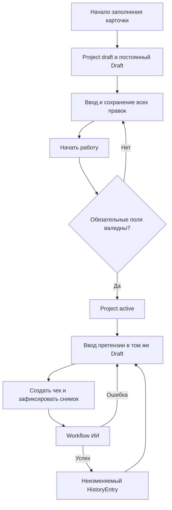
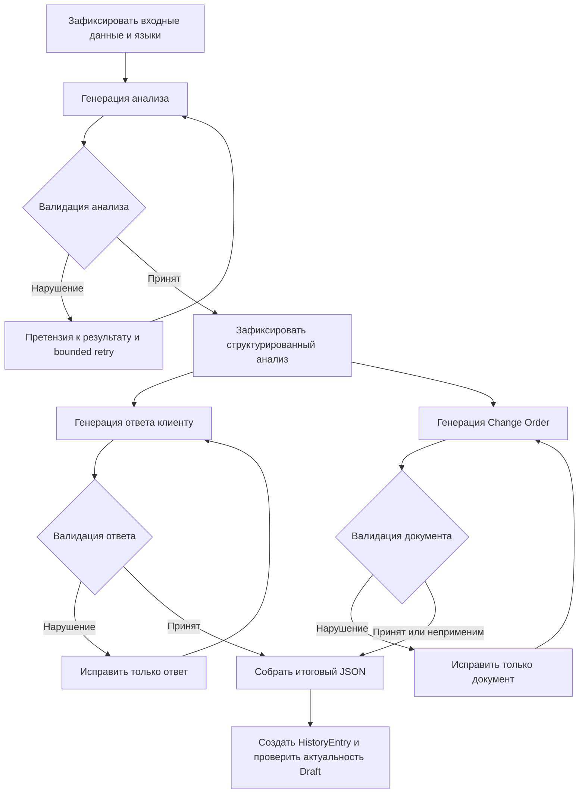
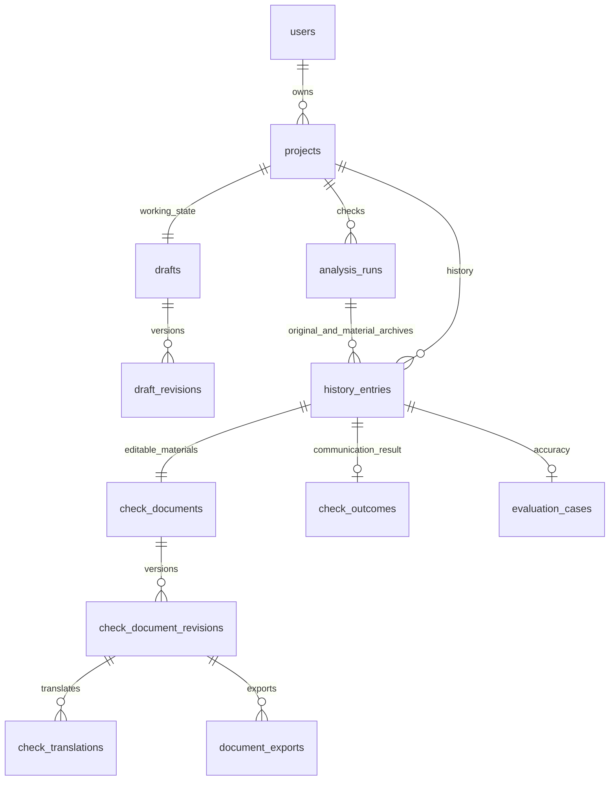

# Проекты, черновики, история и workflow ИИ в ScopeCreepGuard

Дата: 13 октября 2026 года.

Статус: целевой дизайн с корректировками по требованиям заказчика и Linear. Редакция 4: уточнение архитектуры frontend от 19 октября 2026 года; продуктовые уточнения от 17 октября сохранены. Документ описывает требуемое поведение и архитектуру. Он не подтверждает, что все описанные возможности уже реализованы или миграции применены.

## Уточнение по приёмке ANY-702 / ANY-703 — 23 октября 2026 года

Этот раздел и исправления ниже согласуют документ с реализованной схемой и замечаниями Михаила от 20 октября. При конфликте с оставшимися предложениями ниже действуют следующие правила:

- Удаление проекта — бессрочная архивация через `projects.archived_at`. Конечного срока хранения и project purge worker нет. Семидневная очистка — историческое предложение, не действующее требование.
- Завершённая проверка автоматически публикует исходный неизменяемый History snapshot. Для того же анализа допустимы дополнительные явные архивы изменённых материалов; повтор команды и повтор идентичного snapshot дедуплицируются. Это не новая проверка и не изменение оригинала.
- Просмотр History — чтение снимка, без изменения Draft. Только явный Reopen создаёт новую рабочую ревизию, сохраняя исторический оригинал.
- Таблицы `check_documents`, `check_document_revisions`, `check_translations`, `check_outcomes`, статусы неполного проекта и методы `/checks/...` ниже — предложения развития, а не каталог существующей БД/API. Текущие редактируемые материалы находятся в `drafts.draft_document` и `draft_revisions`.
- Реализованные гарантии описаны в [draft-workflow](../architecture/draft-workflow.md); T1/T2 метрик — в [дизайне метрик](profile-behavior-marketing-metrics.md#t1-действие-пользователя). Эта правка документации не требует новой миграции и не добавляет ручные кнопки сохранения в интерфейс.

## Актуальное уточнение: ответ LLM и диагностические проверки — 17 октября 2026 года

Этот раздел фиксирует последнее решение пользователя и имеет приоритет над
противоречащими ему правилами ниже о блокирующей валидации содержания,
обязательном исправлении кандидата и совместной готовности ответа и Change Order.
Предыдущие описания сохранены как контекст дизайна; это не утверждение, что
новое поведение уже реализовано или согласовано с приёмкой в Linear.

### Основной пользовательский flow

1. Пользователь отправляет обращение. Приложение ориентируется на результат LLM
   и показывает полученный пригодный для отображения ответ без отдельной
   процедуры приёмки его содержания нашим кодом.
2. Проверки языка, смысловой согласованности, новизны, чисел, валют, сроков и
   условий сохраняются как внутренние диагностические правила. Их результаты
   не блокируют публикацию, не требуют от пользователя повторять запрос и не
   превращаются в предупреждения или технические пояснения в основном интерфейсе.
3. Change Order формируется отдельно по кнопке «Подготовить соглашение».
   Его генерация и проверки не являются условием показа основного ответа.
   Ошибка соглашения не скрывает уже готовый ответ и не запускает новый анализ.
4. В основном результате не показываются отдельный блок объяснений вердикта,
   цитаты-доказательства, внутренние снимки проекта и техническая диагностика.
   Существующие данные сохраняются для внутренней работы и истории по их
   правилам; скрытие блока не означает удаление записей из БД.
5. Поле сроков и текущий редактор остаются как есть. Предложение добавить
   структурированный срок и новые элементы формы не принято. Структурированные
   часы, сумма и валюта сохраняются; изменение формата свободного срока не входит
   в это решение.

### Проверки работают для логирования, а не как барьер

Сохраняются существующие детекторы, эвристики, парсеры и смысловое ревью.
Подключённые к ним блокировки содержания должны стать результатами диагностики,
а не исключениями, отменяющими пользовательскую операцию. В частности,
неравенство извлечённых из текста чисел или низкая уверенность языка сами по себе
не останавливают ответ. Диагностический отказ или ошибка формата ответа
ревьюера также не отменяют уже полученный результат генератора.

Диагностика не должна задерживать показ готового результата или порождать
обязательный цикл перегенерации до прохождения проверок. Ошибки самой диагностики
изолируются от сохранения и публикации результата. Точный механизм исполнения
и фиксации выбирается в плане реализации; новый отдельный воркер этим решением
не предписан.

Для внутреннего анализа фиксируются идентификаторы операции и этапа, версия
правила, код срабатывания, поле, ожидаемое и наблюдаемое нормализованные значения,
уверенность при наличии, время и технический исход проверки. Используются
существующие механизмы логирования и учёта; новые таблицы автоматически не
требуются. Не копировать в технические логи полные запросы, документы, персональные
данные, ключи, cookies и токены. Отказ диагностического правила и реальный отказ
провайдера учитываются как разные исходы.

### Граница решения

Неблокирующий режим относится к оценке содержания LLM. Сохраняются проверки
аутентификации, владельца, структуры входного запроса и JSON-ответа, допустимых
типов, согласованности редакций, идемпотентности и целостности сохранения.
Бюджеты, ограничения провайдера и транспортные ошибки не отменяются. Нельзя
объявлять успешным отсутствующий ответ, повреждённый JSON или неуспешную запись
в БД. В таких случаях приложение сохраняет доступные данные и показывает
понятную ошибку операции без внутренних сообщений валидаторов.

Ручные коммерческие условия имеют приоритет над AI-предложением. Обновление ставки
влияет на новую оценку, но не переписывает ручную сумму с валютой и исторические
документы. Прежняя политика изменения ставки сохраняется; новых обязательных
действий пользователя это уточнение не вводит.

### Последствия для реализации и приёмки

Нужны отдельные состояния готовности основного ответа и соглашения, исключение
диагностических отказов из причин неуспеха пользовательской операции и тесты,
доказывающие сохранение/показ ответа при срабатывании или сбое диагностики.
Требуется также проверить сохранение результата после reload, защиту редакций,
ручных условий и изоляцию пользователей.

Это сознательное изменение прежней политики: диагностически отклонённое
содержание может быть показано пользователю. Ранее сформулированные критерии
Linear об обязательном отклонении неверного текста нельзя автоматически считать
выполненными по новому правилу. Их согласование с этим дизайном — отдельная
открытая задача; статусы и требования Linear при обновлении документа не меняются.

### Уточнение реализации F1/F2 — 17 октября 2026 года

Редактируемые коммерческие значения и коммерческое представление документа —
разные границы. При `noAdditionalCharge=true` редактор сохраняет сумму, валюту
и основание оценки, включая ручной текст. Проекция документа выводит бесплатное
выполнение и исключает выделенные поля payable amount/currency/rationale.
Трудозатраты, свободный срок и дата окончания остаются. Отключение флага возвращает
обычное платное представление. Описание, примечания и дополнительные условия
не разбираются и не переписываются. Исторические снимки и готовые PDF неизменяемы.
Preview/Copy используют общий frontend builder; PDF — эквивалентную Python-проекцию.
Общий набор контрактных примеров проверяет EN/RU/ES и сохранение исходных значений.

Существующий процесс LLM worker исполняет две независимые async-полосы: одну для
check/regenerate/translate/estimate/agreement и одну только для diagnostics.
В каждой одновременно одна операция. SQL claim явно ограничивает kind без fallback.
При занятой диагностике пользовательская полоса продолжает работу. Каждая операция
владеет своей задачей и heartbeat, использует независимые UoW и прежние lease/epoch,
deadline, бюджет и учёт provider calls. Ошибка цикла изолирована внутри полосы;
пустая очередь ждёт stop event с ограниченным polling. При остановке обе полосы
перестают брать задания, вместе дренируются до единого 30-секундного дедлайна,
затем отменяются с ожиданием учёта неизвестного результата и cleanup. Диагностика
не изменяет документы и не входит в статистику исходов пользовательских операций.

Доказательства и ограничения: [implementation record](../architecture/2026-10-17-commercial-presentation-execution-lanes.md).
Это уточнение не объявляет завершённым browser/clipboard acceptance, недоступный
из-за ошибки запуска встроенного браузера.

## 1. Назначение

ScopeCreepGuard помогает исполнителю сравнить претензию или пожелание заказчика с согласованным scope проекта, получить объяснение результата, подготовить ответ заказчику и Change Order. Сервис сохраняет работу пользователя, позволяет вернуться к незавершённому проекту и хранит каждый успешно созданный чек как самостоятельный исторический результат.

В основе дизайна — PostgreSQL как источник истины, один постоянный Draft на проект, полный журнал изменений и независимые проверки по новым обращениям. Работа ИИ разделена на проверяемые этапы с отдельными языковыми контрактами. Каждый вызов провайдера учитывается для контроля стоимости, ошибок и повторов.

## 2. Согласованные продуктовые правила

1. Незавершённая карточка проекта сохраняется в PostgreSQL.
2. У проекта ровно один постоянный рабочий Draft. Его UUID сохраняется на протяжении жизни проекта.
3. В интерфейсе существует одна вкладка «Мои черновики», одна строка на проект. Незавершённые карточки и рабочие проекты не разделяются по вкладкам.
4. Все пользовательские данные, включая необязательные поля и промежуточные правки, сохраняются в PostgreSQL. Прежнее правило хранения необязательных полей только в браузере заменяется этим решением.
5. Каждая принятая правка создаёт неизменяемую ревизию. История изменений не ограничивается финальным текстом.
6. Заполнение обязательных полей само по себе не активирует проект. Переход происходит при начале работы над проектом после серверной валидации.
7. У активного проекта нельзя сохранить изменение, которое делает обязательные поля невалидными.
8. «Создать чек» всегда запускает новую независимую проверку ИИ по актуальной претензии и условиям проекта.
9. У одного проекта может быть много чеков. Идемпотентность относится к конкретной команде создания чека.
10. HistoryEntry появляется после успешного завершения обязательных этапов команды «Создать чек». Отдельная кнопка сохранения результата в историю не нужна.
11. Ручные правки, автосохранения, выход со страницы и неуспешная генерация не создают HistoryEntry.
12. После создания чека Draft сохраняется. Для следующего обращения пользователь меняет текст в том же окне; отдельной кнопки «Новое обращение» нет.
13. Изменение претензии или условий анализа делает старые результаты неактуальными. Изменение названия проекта или данных клиента не сбрасывает анализ.
14. Удалённый проект архивируется бессрочно; данные и история сохраняются. Ранее предложенные семь дней и окончательная очистка worker не действуют (см. раздел 8).
15. Исходный анализ чека неизменяем. Пользовательские ответы, Change Order и исход общения имеют собственные версии, привязанные к конкретному чеку.
16. Открытие записи истории показывает исходный анализ и последнюю сохранённую редакцию её клиентских материалов. Новый запрос в Draft не лишает доступа к старым правкам.
17. Правка ответа старого чека не создаёт новый чек и не запускает повторную классификацию. Новый чек появляется только по команде новой проверки.
18. Copy и PDF берут выбранную сохранённую редакцию документа. Обязательная отдельная финализация соглашения не вводится.
19. Перевод ответа на язык интерфейса показывается отдельно от клиентского оригинала. Copy клиенту берёт только оригинал.

## 3. Пользовательский workflow

### 3.1. Создание и начало работы

При первом содержательном вводе backend создаёт проект в статусе `draft` и его единственный Draft одной транзакцией. Сетевой повтор не создаёт второй проект. Пустое открытие формы не обязано создавать пустую запись.

Пользователь заполняет карточку и может уйти в любой момент. При возвращении сервис загружает подтверждённое серверное состояние. Незаполненные обязательные поля разрешены в незавершённом проекте.

При действии «Начать работу над проектом» backend проверяет обязательные поля согласно условиям проекта. При ошибке переход блокируется; интерфейс указывает конкретные поля. При успехе проект становится `active`, фиксируется событие `project.started` и открывается то же рабочее пространство.

Обязательность зависит от карточки и модели оплаты: например, для почасовой модели нужна положительная ставка, для fixed fee — положительная стоимость проекта. Email клиента и дата окончания необязательны; дата начала и валюта обязательны для начала работы. Полный набор обязательных полей должен использовать единый серверный контракт с соответствующими сообщениями RU/EN.

### 3.2. Работа с претензией

Пользователь вводит обращение заказчика в постоянное поле Draft. Каждая правка отправляется в API и сохраняется как новая ревизия. В интерфейсе подтверждение «сохранено» появляется только после успешного commit.

После изменения текста прежние анализ, ответ и Change Order скрываются как устаревшие и недоступны для экспорта из текущего рабочего состояния. Они остаются в ревизиях и ранее созданной истории.

Изменение scope, индустрии или коммерческих условий тоже инвалидирует рабочий результат. Исходные условия уже созданных чеков остаются прежними. Название проекта и данные клиента могут обновить оформление текущего документа без новой оценки scope; это явная новая редакция, а не переписывание исторического снимка. Языковые изменения инвалидируют соответствующие представления: изменение языка интерфейса требует нового представления анализа, изменение языка клиентских материалов — нового ответа и Change Order. Они не должны сами менять вердикт.

### 3.3. Создание чека

Перед командой «Создать чек» клиент дожидается сохранения правок. Backend получает ожидаемую ревизию и ключ идемпотентности, проверяет готовность проекта и фиксирует входной снимок.

Новая проверка использует текущие scope, претензию, коммерческие параметры и языки. Предыдущие ответы, ручные правки и прошлый Change Order не включаются в исходный контекст нового чека.

После успешной генерации и валидации всех обязательных материалов одной транзакцией создаются новый полный HistoryEntry, его check_document и первая check_document_revision. Draft сохраняется и получает ссылку на чек только если актуальность его входных данных подтверждена. Это завершение обычной проверки, без отдельного Create draft или Save to history.

Если во время генерации пользователь начал следующую претензию, завершённый чек по прежнему снимку появляется в History, а новое состояние Draft не перезаписывается. Консервативная проверка source revision допустима на первом этапе; сравнение релевантного hash позволяет позже применять результат после изменений, которые не влияют на анализ.

При ошибке Draft сохраняется, HistoryEntry не создаётся, интерфейс показывает возможность повтора. Подтверждённые результаты этапов сохраняются, чтобы технический повтор мог продолжить незавершённую операцию. Уже принятый анализ не теряется из-за ошибки клиентских материалов; он доступен как промежуточный результат незавершённой операции, без выдачи её за готовый чек.

### 3.4. Правки результата и возвращение через историю

После создания чека клиентские материалы редактируются в check_document этого чека. Рабочий Draft содержит active_check_id, но не вторую независимую копию ответов. До первого успешного чека незавершённые поля находятся в draft_document. После привязки чека соответствующие материалы читаются и записываются через check_document.

Пользователь меняет tone, текст ответа, язык и условия Change Order. Каждая правка сохраняется в check_document_revisions. Если чек открыт в актуальном рабочем Draft, его ревизия также фиксирует ссылку на конкретную редакцию материалов. Обновления и события выполняются атомарно. Нет двух конкурирующих источников редактируемого текста.

При открытии History сервис загружает исходный check_snapshot и текущую check_document_revision. Ручные правки старого чека сохраняются независимо от того, какая новая претензия находится в рабочем Draft. Сам просмотр истории и её редактор не подменяют текущую претензию проекта.

Регенерация старого ответа использует исходные scope, коммерческие условия и verdict этого чека. Текущий scope проекта не подставляется. Перед заменой ручной правки пользователь подтверждает действие; при ошибке прежний текст остаётся. Проверяются язык, сохранение позиции и содержательная новизна. Ни регенерация, ни перевод не создают новый HistoryEntry.

Список истории содержит режим «Все проекты», фильтр по проекту, дату и время, краткую суть, verdict, оценку точности и исход общения. Доступны CSV для пользователя и существующий JSONL для технической оценки. Confidence отображается числом только при подтверждённой калибровке; исходное значение модели может храниться для исследования.

### 3.5. Перевод, бесплатная работа и экспорт

Перевод клиентского ответа на язык интерфейса связан с точной ревизией исходного ответа. После редактирования оригинала прежний перевод помечается устаревшим. Перевод не меняет оригинал, язык клиентского документа, verdict или числовые условия. Copy ответа берёт только клиентский оригинал.

Классификация scope и коммерческое решение разделены. Работа вне scope может быть выполнена бесплатно по выбору пользователя. Нулевая цена с явным noAdditionalCharge допустима и не исправляется retry до положительной суммы. Необоснованная нулевая оценка ИИ — отдельный случай валидации. Редактируемые оценки ИИ явно отмечаются как предварительные до подтверждения исполнителем; они не выдаются за согласованные с заказчиком условия.

Перед Copy/PDF сервис проверяет полноту документа: необходимые данные сторон, описание работы, дату, ссылку на scope, стоимость либо явную бесплатность, сроки либо явное согласование, строку подтверждения. Недостающие данные требуют заполнения или понятного предупреждения согласно принятому режиму черновика. Они не придумываются моделью. Обязательные условия проекта и обязательные данные готового документа — разные проверки.

PDF остаётся черновиком с соответствующей пометкой. Копирование и экспорт не означают отправку, принятие клиентом или юридическое подписание. Пользователь может подготовить Change Order и для in_scope через явное действие «Всё равно подготовить»; это не меняет исходный verdict.

Экспорт фиксирует check_document_revision_id и снимок отредактированных условий. Финализация отдельного change_order не обязательна для Copy/PDF. Повтор скачивания того же сохранённого экспорта не запускает новую генерацию ИИ.

Основной экран следует порядку заказчика: verdict → готовый ответ → краткое основание с релевантной цитатой. Подробности раскрываются отдельно. Для borderline видны причина неопределённости и следующий шаг. На ранних этапах экран показывает реальные причины блокировки и путь к исправлению; технические trace IDs, бюджеты и граф выполнения не перегружают интерфейс.



## 4. Сохранение каждой версии и конкурентное редактирование

Каждая принятая пользовательская правка обновляет текущее состояние и создаёт ревизию одной транзакцией:

1. Проверить владельца проекта и возможность записи.
2. Найти результат ранее выполненной команды по `operation_id`.
3. Сравнить `request_hash`; тот же ключ с другими параметрами возвращает конфликт.
4. Проверить ожидаемую ревизию.
5. Обновить Draft и при необходимости карточку проекта.
6. Увеличить `revision`.
7. Записать `draft_revisions` и соответствующее `activity_event`.
8. Выполнить commit и вернуть подтверждённое состояние.

Условное обновление выполняется по `id` и `expected_revision`. При конфликте backend возвращает `409`; интерфейс сохраняет неподтверждённый ввод для сравнения и не перезаписывает серверные данные молча.

Требование «сохранять все версии» исключает объединение нескольких отдельных правок в один debounce-снимок с потерей промежуточных состояний. Клиент сериализует команды и сохраняет их порядок. Составное событие ввода, например вставка текста или завершение IME-композиции, может быть одной правкой.

Простой debounce из прежней реализации должен быть пересмотрен. Подтверждённым считается только то, что дошло до PostgreSQL. При отсутствии сети немедленная запись невозможна: интерфейс сообщает, что данные не сохранены. Временная очередь клиента допустима для доставки и защиты ввода, но не заменяет серверное хранение и не отправляется поверх чужих изменений без проверки ревизии.

Ревизия Draft содержит полный снимок рабочего состояния и условий проекта, а также точную ссылку на редакцию активного чека, если он есть. Ревизия check_document хранит полный снимок клиентских материалов конкретного чека. Восстановление создаёт новую ревизию соответствующей сущности, не переписывая прежнюю. Персональные данные и тексты доступны только владельцу. Для сохранения check_document применяется собственный expected_revision; эта проверка не конфликтует с вводом новой претензии в другом Draft-контексте.

## 5. Workflow модели и матрица языка

### 5.1. Три этапа

| Этап | Вход | Результат | Обязательный язык |
| --- | --- | --- | --- |
| Анализ для пользователя | Scope, претензия, условия проекта | Вердикт, summary, reasoning, citations, suggestion, оценки | Язык интерфейса |
| Ответ заказчику | Проверенный анализ, исходные scope и претензия, условия | Самостоятельные warm, neutral и firm ответы | Язык претензии или явный выбор языка клиентских материалов |
| Change Order | Тот же проверенный анализ и исходные условия | Описание дополнительной работы и условия документа | Тот же язык клиентских материалов |

Языки определяются и фиксируются до генерации. При смешанном или языково нейтральном обращении применяется явный выбор пользователя либо существующий документированный fallback. Модель не меняет целевой язык по собственной инициативе во время retry.

Ответ заказчику и Change Order используют один структурированный анализ. Они не получают право самостоятельно менять verdict или придумывать новые договорённости. Эти этапы могут выполняться параллельно после принятия анализа.

Под «чеком» понимается полный результат проверки в History. Отдельный вызов модели для упаковки чека в JSON не нужен: backend собирает его из валидированных объектов. Если Change Order не применим к вердикту, этап возвращает явное `not_applicable` согласно контракту; это не является ошибкой генерации.

### 5.2. Разделение компонентов

| Компонент | Ответственность |
| --- | --- |
| Backend services | Порядок этапов, переходы, актуальность входа, транзакции, публикация результата |
| PydanticAI | Structured output, output validators и ограниченные исправляющие попытки |
| ProviderGateway | Политика модели, timeout, общий бюджет, transport retry, разрешённый fallback и учёт вызовов |
| LiteLLM adapter | Унифицированное обращение к провайдеру и нормализация его ответа |
| PostgreSQL | Состояние выполнения, принятые результаты, попытки, ошибки и стоимость |

Workflow имеет фиксированные переходы. LangGraph допустим как реализация графа, если нужны checkpoint и восстановление длительного выполнения; выбор этой библиотеки ещё не обязателен. Если он используется, каждый checkpoint связан с операцией и входным снимком в PostgreSQL. LangChain не должен создавать параллельный неконтролируемый путь вызова провайдеров или собственную историю пользовательских чеков.



### 5.3. Проверка и исправление

Каждый этап проверяет форму JSON, обязательные поля, фактический язык текста и доменные ограничения. Значение `language = en` само по себе не подтверждает английский язык содержимого.

Проверка языка исключает дословные citations, имена, URL и названия продуктов. Для коротких и смешанных фраз возможен результат «недостаточно уверенности»; нельзя считать наличие отдельных кириллических символов универсальным доказательством неверного языка.

При нарушении валидатор формирует конкретную претензию: поле, нарушенное правило, ожидаемый язык, обнаруженный язык и требование исправить текст, сохранив факты и scope. PydanticAI запускает исправляющую попытку через тот же gateway. Локальный контекст исправления текущего этапа не переносится в новую независимую проверку другой претензии.

Попытки ограничены числом вызовов, общим deadline и бюджетом. Начальная рекомендация — один исходный вызов и две исправляющие попытки; это настраиваемая политика, а не гарантия успеха. После исчерпания лимита используется разрешённый fallback либо возвращается ошибка. Невалидные материалы не публикуются как готовый чек.

Native structured output провайдера сохраняется, где он поддерживается. PydanticAI дополняет его проверкой содержания. Проверка JSON не доказывает правильность бизнес-вердикта; качество также оценивается через regression-наборы и `evaluation_cases`.

## 6. Целевая система таблиц

PK новых бизнес-сущностей — UUID. Существующие UUID сохраняются. Время хранится как `TIMESTAMPTZ` в UTC; календарные условия проекта — как `DATE`. Деньги представлены `NUMERIC` и `Decimal`. Статусы, ссылки и поля поиска находятся в колонках; составные документы и неизменяемые снимки — в версионированном JSONB.

### 6.1. Пользователь, проект и работа

| Таблица | Основные данные | Связи и ограничения |
| --- | --- | --- |
| `users` | Email, password hash, даты | Уникальный нормализованный email; владелец проектов |
| `user_preferences` | Язык интерфейса, timezone и настройки отображения | Один набор на пользователя; явные настройки не заменяются выводами профиля |
| `auth_sessions` | Hash токена, expiration, отзыв, устройство | Много на пользователя; отдельная возможная задача развития auth |
| `projects` | Карточка, scope, коммерческие условия, status, даты удаления, creation key/hash | Один владелец; `draft`, `active`, `deleted`; активные условия валидны |
| `drafts` | Текущий request, поля до первого результата, active_check_id, ссылка на анализ, staleness, revision | `UNIQUE(project_id)`; не требует HistoryEntry; не дублирует editable document активного чека |
| `draft_revisions` | Полный state/context snapshot, schema version, reason, actor, operation/hash | `UNIQUE(draft_id, revision)` и `UNIQUE(draft_id, operation_id)`; append-only |
| `analysis_runs` | Frozen scope/request, языки, source revision, статус и принятый анализ | Принадлежит проекту; уникальная ссылка на операцию workflow |
| `history_entries` | Полный check snapshot, source revision, analysis run, author/time/key/hash | Много чеков на проект; один автоматический исходный snapshot и дополнительные явные архивы изменённых материалов; analysis run → 0..N HistoryEntry |
| `check_documents` | History ID, editable replies, выбранный tone, Change Order, язык, revision, время | `UNIQUE(history_entry_id)`; единственное актуальное состояние материалов этого чека |
| `check_document_revisions` | Полный snapshot материалов, revision, reason, actor, operation/hash/time | `UNIQUE(check_document_id, revision)` и `UNIQUE(check_document_id, operation_id)`; append-only |
| `check_translations` | Source document revision, target locale, translated reply, model/prompt/time | Перевод для проверки смысла; точная связь с редакцией оригинала |
| `check_outcomes` | History ID, исход общения, комментарий, revision/time | Отдельно от verdict и accuracy: pending, replied, free_work, estimate_issued, client_declined и другие согласованные исходы |
| `change_orders` | Опциональный зафиксированный content snapshot/reference | Связан с History и редакцией документа; развитие жизненного цикла не является условием Copy/PDF |
| `document_exports` | PDF-задача, source check_document_revision_id, object key, checksum, size, lease/attempt/error | Экспорт точной редакции; файлы в приватном object storage |
| `activity_events` | Тип действия, actor, ссылки, changed fields, operation, timestamp | Серверные семантические события; полный текст не дублируется |
| `evaluation_cases` | Correct/Wrong/Debatable и исходный анализ | Оценка конкретного чека; не зависит от изменившихся условий проекта |

Полный History snapshot включает претензию, scope и условия на момент запуска, языки, verdict/confidence/summary/reasoning/citations/suggestion, три исходных ответа, применимый исходный Change Order и оценки, source revision, модель и версии prompt. Пользовательские правки находятся в check_document_revisions; API открытия возвращает исходный снимок и последнюю сохранённую редакцию. Список истории использует отдельные колонки summary/verdict/completed_at, чтобы не читать большие JSON ради каждой строки. Представление summary/основания на текущем языке интерфейса может храниться отдельно с привязкой к исходному снимку и не изменяет его.



### 6.1.1. Пути API и границы операций

Ниже целевые логические методы; точные названия согласуются с существующим /api/v2 контрактом при реализации.

| Действие | Метод/путь | Вход и результат |
| --- | --- | --- |
| Сохранить неполный проект | `POST /api/v2/projects` | Creation key и частичные поля; Project draft и единственный Draft |
| Начать работу | `POST /api/v2/projects/{id}/start` | Expected revision/operation; проверка обязательных полей и active |
| Сохранить рабочий Draft | `PATCH /api/v2/drafts/{id}` | Expected revision, operation ID, изменения; новая Draft revision |
| Создать чек | `POST /api/v2/drafts/{id}/checks` | Source revision/idempotency key; операция и исходный HistoryEntry; дополнительные архивы материалов не запускают новый анализ |
| Проверить выполнение | `GET /api/v2/operations/{id}` | Owner-scoped состояние этапов и результат без нового вызова ИИ |
| Открыть историю | `GET /api/v2/checks/{id}` | Immutable analysis и latest edited materials |
| Сохранить правку чека | `PATCH /api/v2/checks/{id}/document` | Expected document revision/operation; новая редакция, без нового чека |
| Регенерировать ответ | `POST /api/v2/checks/{id}/replies/regenerate` | Tone, source document revision, key; исторический контекст и новая редакция |
| Перевести для проверки | `POST /api/v2/checks/{id}/translations` | Source document revision/target locale/key; отдельный перевод |
| Сохранить исход общения | `PATCH /api/v2/checks/{id}/outcome` | Expected revision/operation; исход без изменения verdict |
| Подготовить PDF | `POST /api/v2/checks/{id}/exports` | Source document revision/key; PDF черновика после проверки полноты |

Любой ID проверяется через владельца проекта. При позднем завершении регенерации новая редакция применяется только к ожидаемой версии документа; иначе сохраняется результат операции и возвращается конфликт, без замены новой ручной правки. Исторический редактор не требует восстановления материалов в текущий Draft проекта.

### Реальные DB- и service-гарантии связности

Миграции `0002_workflow_expand` и `0003_workflow_constraints` связывают Draft revisions с `(draft_id, project_id)`, анализы с владельцем проекта и source Draft/revision, History с исходной ревизией, анализом и сохраняющим владельцем; change_orders/document_exports также имеют составные ссылки проекта. `0006_profile_metrics` связывает проекты, события и продуктовые сессии с профилем составными FK. Append-only triggers и `ON DELETE RESTRICT` защищают сохранённые записи.

Это не универсальная гарантия для всех таблиц: `llm_operations` имеет независимые одноколоночные FK на owner/project/draft/run, а `provider_calls` — на operation и step. Сами эти FK не доказывают соответствие owner/project/draft/run или принадлежность step указанной operation. Эти соответствия проверяют сервисы и репозитории при создании/исполнении операций. Нельзя описывать их как уже обеспеченные составным FK БД. Новые ограничения здесь не вводятся.

### Транзакционные границы

T1 фиксирует бизнес-изменение, ревизию и соответствующее событие атомарно. После COMMIT и освобождения соединения UoW запускает пересчёт `marketing_metrics` в отдельной T2; ошибка T2 не откатывает T1. См. `backend/src/scope_guard/database/unit_of_work.py` и дизайн метрик. Вызов LLM находится вне этих транзакций; резервирование/учёт provider call, сохранение результата и применение к ожидаемой ревизии — отдельные короткие транзакции, а не одна транзакция на время сети.

### 6.2. Выполнение ИИ и стоимость

Общая пользовательская операция создания чека имеет этапы. Рекомендуется одна `llm_operations` для всего workflow и отдельные `llm_steps` для анализа, ответа и документа. Регенерация, перевод или обновление профиля являются самостоятельными операциями. Это позволяет применять один бюджет и deadline на весь чек.

| Таблица | Основные данные |
| --- | --- |
| `llm_operations` | Operation kind, actor/project, source revision, idempotency key/hash, policy version, status, deadline, лимиты, время |
| `llm_steps` | Operation ID, step key, версия входа/hash, статус, принятый output, schema/prompt version, error и время |
| `provider_calls` | Step ID, physical/semantic/transport attempt, requested/actual model/provider, reasoning, статус, usage, стоимость, latency и SDK/provider IDs |
| `llm_validation_failures` | Call/step ID, field path, rule code, expected/detected language, confidence проверки, время |
| `llm_policy_versions` | Неизменяемый набор моделей, fallback, retry, timeout, бюджета и разрешённых параметров |
| `provider_price_versions` | Provider/model, тарифные единицы, input/output/cache rates, валюта, период действия, источник |
| `usage_budget_reservations` | User/operation/period, резерв, фактическое потребление, статус закрытия |

По миграции `0005_llm_workflow` у `llm_steps` уникально `(operation_id, stage_key)`; у `provider_calls` — `(operation_id, physical_index)` и `(step_id, semantic_attempt, transport_attempt)`. Физический индекс имеет область operation, а не step. Вызовы не требуют хранения полного prompt в telemetry: исходный контекст хранится в защищённых снимках, а технические записи содержат версии и ссылки.

Usage и стоимость допускают `NULL`, если провайдер их не сообщил. Отдельно фиксируются `usage_status` и `cost_status`. Неизвестная стоимость не равна нулю. Стоимость записывается с достаточной точностью, например `NUMERIC(20,10)`, и валютой.

Cached/reasoning tokens могут быть частью общих input/output counters: тарификация зависит от провайдера и не должна считать их повторно. Отклонённый валидатором ответ включается в расходы. Стоимость операции равна сумме всех известных расходов по её вызовам; отчёт показывает долю вызовов с неизвестной стоимостью.

Transport retry имеет одного владельца. Скрытые повторы внутри SDK отключаются либо учитываются через hooks; иначе число gateway attempts не соответствует реальным вызовам. Общий лимит проверяется по сохранённому состоянию, а не только по счётчику в памяти.

### 6.3. Profile

Профессиональный профиль содержит введённые пользователем данные и выводы из подтверждённой деятельности. Он помогает подставлять условия и показывать рабочие предпочтения. Автоматические выводы не переписывают ручные значения.

| Таблица | Основные данные |
| --- | --- |
| `user_profiles` | User ID unique, display/business/provider name, manual values, derived values, revision, время обновления |
| `profile_revisions` | Версия снимка, период наблюдения, sample size, reason, метод расчёта, model/prompt при использовании ИИ |
| `profile_evidence` | Profile revision, поддерживающий event/check, характеристика и основание вывода |
| `profile_refresh_jobs` | Запрос обновления, обработанная граница событий, status, lease, attempts/error |

Например, предпочтение neutral должно иметь основание «14 из 20 подтверждённых выборов за последние 90 дней». Текст случайного незавершённого Draft не считается достоверным профессиональным предпочтением.

Одновременно достаточно одной активной задачи refresh на пользователя. Новые события во время обработки не теряются: worker фиксирует обработанную границу и повторяет обновление при наличии более новых данных.

Использование derived profile как контекста scope-анализа пока не согласовано. Базовый сценарий — статистика и предлагаемые defaults. Профиль не должен менять согласованный scope или выводить обязательства из предпочтений пользователя. Удаление оснований и пересчёт профиля при физическом purge остаются будущим предложением: project purge сейчас не выполняется.

## 7. Идемпотентность, восстановление и транзакции

| Команда | Уникальный scope |
| --- | --- |
| Создать проект | `(user_id, creation_key)` |
| Изменить Draft/карточку | `(draft_id, operation_id)` |
| Изменить материалы чека | `(check_document_id, operation_id)` |
| Создать чек | `(project_id, operation kind, idempotency_key)` |
| Создать этап workflow | `(operation_id, step_key)` |
| Создать HistoryEntry | `analysis_run_id` и ключ команды |
| Финализировать соглашение | `(history_entry_id, idempotency_key)` |
| Создать экспорт | `(check_document_id, idempotency_key)` с hash исходной ревизии |

Повтор с тем же ключом и hash возвращает существующий результат или статус выполняющейся операции. Проверка завершённого повтора предшествует проверке устаревшей ревизии. Тот же ключ с другими параметрами возвращает `409`.

Новый сознательный клик для нового чека получает новый ключ, даже если текст совпадает. Технический повтор сохраняет ключ. Это не ограничение «один чек на проект» и не дедупликация разных претензий по их тексту.

Backend сохраняет входную операцию короткой транзакцией; внешние LLM-вызовы выполняются вне транзакции. Provider telemetry фиксируется независимо от возможного rollback публикации результата, иначе расходы неуспешной операции исчезнут.

Результаты этапов сохраняются после валидации. Продолжение операции использует те же входные снимки и версии политик, не текущую изменившуюся конфигурацию проекта. При исчерпанном бюджете операция не перезапускается бесконечно.

Сервис гарантирует одну принятую операцию и одну запись чека. Он не гарантирует exactly-once исполнение внешнего LLM-запроса: после timeout провайдер мог уже выполнить работу. Неопределённые вызовы сохраняются как `unknown` с явной политикой повтора.

## 8. Архивация и retention

Действующее удаление задаёт `projects.archived_at` и сохраняет проект, Draft, ревизии, анализы, History и документы. Архив исключён из обычной выборки проектов; его история остаётся доступной владельцу. Изменения и новые LLM-операции архивного проекта запрещены. Просмотр истории не изменяет рабочий Draft; Reopen — отдельная явная операция для доступного рабочего проекта.

Срок окончательного удаления не задан. Project purge worker, `deleted_at`, `purge_after`, lease очистки и гонка restore/purge — историческое предложение, не действующая схема и не критерий приёмки. Разработка восстановления и конечной retention-политики требует отдельного scope; эта документационная правка их не вводит.

Экспортный worker и очистка orphan-файлов не являются удалением проектов. Настраиваемая retention экспортов описана отдельно в `docs/architecture/draft-workflow.md`; она не задаёт срок хранения History.

## 9. Метрики и отчётность

Источник требований — `saas_metrics.docx`, прочитанный 13 октября 2026 года. Это справочник, поэтому определения продукта и источники финансовых данных задаются отдельно.

| Группа | Источники | Определение для ScopeCreepGuard |
| --- | --- | --- |
| Activation, Time to Value | Users и первый успешный HistoryEntry | Предлагаемая activation: первый успешно созданный чек; TTV — время от регистрации |
| Onboarding | Setup/start events | Начало карточки и успешный переход к работе; факт started сохраняется отдельно от текущего статуса проекта |
| DAU/MAU, Feature Adoption | Семантические events | Значимые действия; технические retry и каждый символ не раздувают число пользователей |
| Sessions и длительность | `product_sessions` | Посещения продукта с версионированным правилом inactivity; отдельно от auth-сессий |
| Retention | Когорты регистрации/активации и возвраты | D7/D30 и активность по выбранным окнам; отдельно от оттока подписок |
| NPS/CSAT/CES | `survey_responses` | Реальные ответы с версией вопроса и шкалой |
| Health Score/PQL | Проверенные события и версии правил | Объяснимая формула и ссылки на основания |
| LLM economics | Operations, calls и prices | Стоимость успешного/неуспешного чека, latency, validation/retry/fallback rates, token usage |
| MRR/ARR/NRR/GRR/ARPU | Подписки и история тарифов | Требуются billing-источники и единое определение платящего аккаунта |
| CAC и conversion | Attribution, маркетинговые расходы, оплаты | Когорты и окна атрибуции; подписка не выводится из наличия проектов |
| Gross/Contribution Margin | Выручка и прямые расходы | LLM — часть COGS; также учитываются storage, hosting и другие расходы |
| Support и sales | Поддержка/CRM | Претензия заказчика в проекте не является support ticket нашего SaaS |
| Burn/Runway/Rule of 40 | Финансовые источники | Не вычисляются достоверно из продуктовых событий |

Дополнительные таблицы измерения: `product_sessions`, `acquisition_attributions`, `survey_responses`, `metric_definition_versions`. Производные отчёты строятся SQL views или обновляемыми агрегатами с указанием версии определения и времени расчёта.

В определении метрики фиксируются numerator/denominator, окно и timezone, cohort, активирующие события, исключения test/internal аккаунтов, дедупликация, обработка удаления и missing data. Метрики отражают факты; профиль пользователя не заменяет их первичные источники.

Финансовые определения требуют проверки: в исходном справочнике Churned MRR местами включает даунгрейды, а Contraction вычитается дополнительно. Для расчётов нужны непересекающиеся категории cancellation и contraction, чтобы избежать двойного счёта. Оценка additionalCost в Change Order не является выручкой SaaS и не доказывает, что клиент исполнителя оплатил работу.

Возможное удаление проектных текстов и оснований профиля после purge относится к будущей политике, не к текущей архивации. Долгосрочные метрики допустимо сохранять в агрегированном виде без содержания удалённых проектов. Политика финансового хранения проектируется отдельно при введении billing.

## 10. Индексы и масштабирование PostgreSQL

| Запрос | Индекс/ограничение |
| --- | --- |
| Проекты пользователя | `(user_id, status, updated_at DESC, id)` |
| Архив проектов (реализовано) | `projects_owner_listing(user_id, archived_at, created_at DESC)`; purge-индекса нет |
| Рабочий Draft | `UNIQUE(project_id)` |
| Ревизии | `UNIQUE(draft_id, revision)`, индекс порядка ревизий |
| Редакции конкретного чека | `UNIQUE(check_document_id, revision)` и `UNIQUE(check_document_id, operation_id)` |
| Материалы чека | `UNIQUE(history_entry_id)` |
| Повторы записи | `UNIQUE(draft_id, operation_id)` |
| История | `(project_id, completed_at DESC, id)` |
| Запуски | `(project_id, created_at DESC)` |
| Вызовы модели | `UNIQUE(operation_id, physical_index)`, `UNIQUE(step_id, semantic_attempt, transport_attempt)`; аналитический индекс по времени/модели при необходимости |
| События | `(project_id, created_at DESC)` и `(actor_user_id, created_at DESC)` под пользовательские отчёты |
| Очереди | Частичные индексы pending/processing по next attempt/lease |

Все большие списки используют pagination; репозитории выбирают нужные поля и не запускают отдельный запрос для каждой строки. JSONB не индексируется GIN без подтверждённой потребности фильтрации. Full snapshots и частые ревизии увеличивают объём; нужны измерение размера и последующее partitioning при реальном росте, без удаления версий вопреки согласованному правилу.

## 11. Границы ответственности и сопоставление с AnyToolAI

`apps/api` содержит HTTP parsing, schemas, auth extraction и composition root. `backend/services` управляет workflow и транзакциями; `backend/domain` — неизменяемыми значениями, валидацией и правилами. `backend/database` содержит фактические SQLAlchemy mappings, специализированные репозитории, read queries и UoW. `backend/integrations` содержит SDK adapters. `apps/worker` запускает существующие роли export/LLM; purge и отдельный profile worker не являются реализованными ролями.

Repository слой следует разделить по предметным операциям: projects, working drafts/revisions, checks/history, LLM execution, profiles, exports/cleanup. Репозитории не commit-ят и не вызывают модель. ORM-объекты не выходят из database layer; API schemas и domain dataclasses не являются одним классом.

Из AnyToolAI берутся отдельные provider calls, semantic/transport attempts, policy versions, correlation IDs, bounded retry, sanitization events и устойчивый worker. Tenant/product/scenario platform tables не переносятся автоматически: для ScopeCreepGuard достаточно текущих предметных связей. Неизвестные расходы остаются NULL, а стоимость использует Decimal вместо float.

## 12. Совместимость с текущей реализацией и проверки

На момент исследования в проекте уже существуют workflow-миграции `0002–0004`, `draft-workflow.md`, export worker и расширенный repository. Это частичная реализация близкой модели. Бессрочный archive и debounce остаются текущим поведением. Исходный History публикуется автоматически после проверки; дополнительные архивы материалов допускаются явно. Оставшиеся предложения этого документа не отменяют эти правила.

Записанные Alembic revisions не переписываются. Изменения вводятся последующими миграциями с расширением nullable-полей, переносом данных, проверкой backfill и последующим ужесточением ограничений. Исторические UUID, ссылки evaluation и исходные legacy envelopes сохраняются. Отсутствующие исторические результаты или provenance не выдумываются.

Перед реализацией необходимо сверить фактическую схему и применённый Alembic head. Добавление таблиц должно сопровождаться обновлением SQLAlchemy metadata и repository mapping; baseline-модели не должны ошибочно описывать contracted workflow-схему. Версии prompt, policy, result schemas и API contracts обновляются согласованно.

Обязательные сценарии проверки целевого дизайна:

- Возврат к неполной карточке проекта после перезагрузки и с другого устройства.
- Полный журнал последовательных правок без пропуска промежуточных версий.
- Блокировка начала работы и невалидного редактирования active проекта.
- Одна команда создания чека при двойном клике или повторе HTTP; новая команда создаёт новый чек.
- RU/EN интерфейс при RU/EN/ES и других поддерживаемых языках претензии; неверный язык вызывает bounded retry.
- Отдельный повтор проблемного этапа без повторной генерации принятых этапов.
- Late result не заменяет новую претензию и всё же создаёт свой успешный чек.
- Конфликт двух вкладок сохраняет пользовательский ввод и не применяет last-write-wins.
- Стоимость включает отвергнутые ответы и показывается как unknown при отсутствии usage.
- Архивация, исключение из активных проектов/черновиков и доступность неизменной History. Семидневный purge и гонка restore/purge исключены из текущей приёмки.
- Profile пересчитывается после удаления его оснований.
- Ручная правка чека A доступна из истории после создания чека B и с другого устройства.
- Открытие или редактирование старого чека не заменяет текущую претензию проекта.
- Регенерация чека A после смены scope использует его исторический scope и предупреждает о замене правки.
- Copy/PDF соответствуют выбранной редакции; неполный документ явно требует заполнения.
- Перевод для проверки обновляется после правки оригинала, Copy не включает перевод.
- Бесплатное выполнение работы вне scope не меняет verdict и не отклоняется как ошибочная нулевая цена.

## 13. Соответствие scope заказчика и приоритеты

| Требование | Linear | Решение дизайна |
| --- | --- | --- |
| Матрица языка и ручной выбор | ANY-543, ANY-635 | Три этапа, language validation и bounded retry; понятные названия языков |
| Три полных самостоятельных ответа | ANY-544 | Генерация warm/neutral/firm с позицией и следующим шагом |
| Обычная проверка сохраняется без Create draft | ANY-548 | Успех «Создать чек» автоматически создаёт History и документ |
| Последняя ручная редакция доступна из истории | ANY-549 | Check documents и отдельные ревизии по каждому чеку |
| Новый вариант без смены scope-позиции | ANY-553 | Frozen контекст чека, подтверждение замены, отдельный retry |
| Редактируемый связный CO, полнота, Copy/PDF | ANY-554 | Экспорт выбранной редакции без обязательной финализации; estimates не выдаются за approval |
| Перевод смысла для пользователя | ANY-555 | Отдельная версия перевода, Copy только оригинала |
| Все проекты, время, outcome, accuracy, CSV | ANY-556 | Фильтры истории, check_outcomes и пользовательский экспорт |
| Пограничные случаи и калибровка | ANY-551, ANY-552 | Эталонный набор, повторные прогоны, отдельная политика confidence и бесплатных мелочей |
| Готовый ответ в центре экрана | ANY-550 | Verdict → ответ → краткое основание, подробности свёрнуты |
| Первый запуск и причины блокировки | ANY-545, ANY-546 | Последовательные подсказки и действие исправления конкретного поля |
| DOCX, Markdown, мобильный экран, доступность | ANY-557 | Отдельные UI/upload deliverables; данный дизайн не закрывает их автоматически |

Обязательные продуктовые исправления и инфраструктурное развитие выполняются отдельно. Persistent incomplete projects, все промежуточные ревизии, семидневный purge (историческое, не действующее предложение), derived profile и расширенная SaaS-аналитика согласованы с пользователем в обсуждении, но превышают исходный объём исправлений отчёта. Они не должны стать условиями приёмки базовой истории, языка и Copy/PDF.

Gateway/LiteLLM/PydanticAI — технический способ обеспечить требования. Наличие библиотек не является критерием готовности. Для нового pipeline измеряются latency и стоимость относительно прежнего сценария; отмеченные заказчиком около десяти секунд анализа — ориентир для сравнения, а не обещанный SLA. AI-формулы Hourly/Fixed fee остаются исследованием ANY-586; дизайн не утверждает коэффициенты или минимальные цены заранее.

Источники сверки: исходный PRD FR-7, отчёт ScopeCreepGuard-report-all-2026-09-28 (1).docx и тикеты Scope Creep Guard в Linear, включая комментарии приёмки от 8 и 11 октября 2026 года. Предложенные новые таблицы/API являются дизайном и требуют отдельной реализации и проверки.

Документ фиксирует целевой дизайн. Он не является выполненным планом миграции, отчётом о применении схемы или разрешением на изменение runtime. Конкретный implementation plan при начале разработки хранится в `docs/architecture/plans/` согласно правилам репозитория.

## 14. Самостоятельный React frontend — решение от 19 октября 2026 года

### 14.1. Цель и статус решения

Согласован переход с Next.js на самостоятельное React-приложение. Текущий UI уже
использует React; перенос касается оболочки, маршрутизации, сборки, локализации
и серверных обязанностей Next.js. Причины — удобство дальнейшей поддержки
пользователем и развитие frontend с явными границами ответственности.
Сам по себе React не устраняет ошибки состояния и не гарантирует масштабируемость.

Это целевая архитектура, а не выполненная миграция. Настоящее уточнение не меняет
продуктовые правила, язык результатов, состав оценки scope, History/Draft,
коммерческие условия, метрики или политику диагностики LLM. При переносе сохраняются
текущие пользовательские возможности, оформление и проверенные сценарии.
Изменения UX согласуются и проверяются отдельно от замены основы приложения.

### 14.2. Образцы и границы заимствования

Исследованы соседние репозитории `PromptTune` и `anytoolai-platform`.
Из PromptTune берётся простота отдельного React-клиента и разделение UI,
API-клиента, типов, storage и адаптеров среды. Его WXT, extension background,
content scripts и локальная библиотека не переносятся в веб-кабинет автоматически.
Большой корневой `App.tsx` также не является образцом организации нашего состояния.

Из AnytoolAI берутся направление зависимостей, отдельный транспортный клиент,
типизированные контракты, конфигурация и тестируемые границы. Значительная часть
его UI пока является scaffold: это источник архитектурных правил, а не готовая
система компонентов. Отдельные workspace-пакеты нужны только при реальном повторном
использовании несколькими приложениями; для ScopeCreepGuard достаточно модулей
внутри одного frontend. Frontend не содержит системных промптов, секретов,
выбора провайдера или серверных правил исполнения LLM.

### 14.3. Структура и направление зависимостей

```text
frontend/
├── src/
│   ├── app/                 # Запуск, провайдеры, маршруты и композиция
│   ├── pages/               # Экраны, собранные из функциональных модулей
│   ├── features/
│   │   ├── auth/
│   │   ├── projects/
│   │   ├── analysis/
│   │   ├── drafts/          # Автосохранение, очередь и восстановление
│   │   ├── history/
│   │   └── change-orders/
│   └── shared/
│       ├── api/             # HTTP, ошибки и генерируемые типы OpenAPI
│       ├── ui/              # Общие компоненты без предметной логики
│       ├── config/          # Проверенная публичная конфигурация
│       ├── i18n/            # Провайдер и словари RU/EN
│       └── storage/         # Адаптеры браузерного хранилища
├── public/
├── package.json
└── Dockerfile
```

`app` собирает провайдеры и страницы; `pages` собирает функциональные модули;
`features` использует `shared`. Общие модули не импортируют страницы или предметные
модули. Между features используются явные публичные контракты, без циклических
зависимостей и доступа к внутреннему состоянию соседнего модуля. Внутри feature
UI, операции API и состояние разделяются по необходимости, без пустых обязательных
слоёв. Существующие компоненты переносятся и адаптируются, а не переписываются
ради нового дерева.

Проекты, проверка, история и черновики получают отдельные маршруты. Ссылки на
сохранённые объекты и текущие параметры восстановления должны сохранить поведение
либо получить явную совместимость. Сборщик, например Vite, и библиотека маршрутизации
закрепляются в плане реализации; эта структура не предполагает Next.js App Router.

### 14.4. Состояние, API и сохранение

- Компоненты отображают данные и отправляют пользовательские намерения через
  обработчики; транспортные повторы и persistence не реализуются внутри формы.
- Серверные данные, локальное состояние формы и состояние выполняемой операции
  имеют разные обязанности и не копируются без необходимости в общий store.
- PostgreSQL остаётся источником подтверждённых проектов, Draft и History.
  Browser storage используется для настроек и восстановления неподтверждённых
  правок; не заменяет серверную запись.
- Сохраняются очередь автосохранения, идемпотентные команды, частичные правки,
  ограниченные повторы, восстановление и защита новых правок от старого ответа.
  Общий HTTP-клиент не добавляет автоматический повтор всех POST/PUT/PATCH.
- `shared/api` отвечает за транспорт, нормализацию ошибок и общие заголовки.
  Методы конкретных ресурсов принадлежат соответствующим features. Типы берутся
  из существующего OpenAPI-контракта; его снимок остаётся в `ci/contracts/`.
- Дублирование старого `StoreProvider` и нового `PersistentStoreProvider`
  устраняется после подтверждения функционального покрытия нового workflow.
  Старый локальный путь не переносится как второй полноценный режим приложения.

### 14.5. Развёртывание и безопасность границ

```text
Браузер → reverse proxy
             ├── /        → статические файлы React frontend
             └── /api/*   → FastAPI → PostgreSQL / существующий LLM workflow
```

Frontend собирается отдельно и раздаётся веб-сервером в контейнере. Node.js нужен
для сборки и разработки; Next.js runtime в целевой схеме отсутствует. Публичный
origin остаётся единым. Development proxy обеспечивает совместимый путь `/api`.
Deep links должны открываться после reload через корректный SPA fallback;
неизвестный API-путь не должен возвращать HTML приложения вместо ошибки API.

FastAPI владеет аутентификацией и авторизацией. Frontend получает состояние
пользователя через `/api/auth/me`; клиентские переходы на login не являются
защитой API. Сессионная cookie сохраняет необходимые атрибуты и поведение logout.
`AUTH_SECRET`, адреса внутренних сервисов и ключи провайдера не включаются
в клиентскую сборку. Публичная конфигурация имеет единую точку чтения и валидации.

При удалении Next.js proxy инвентаризируются и сохраняются его обязанности:
проверка Origin и защита cookie-запросов, ограничения загрузки, передача cookie,
скачивание PDF/экспорта, `Content-Disposition`, cache policy, ошибки, отмена,
таймауты и служебные заголовки. Уже существующие backend-проверки не дублируются
в браузере как замена серверной защите. Отдельно переносится смена языка:
словарь RU/EN и пользовательский выбор сохраняются без зависимости от
`router.refresh()` и серверного Next.js provider.

### 14.6. Порядок переноса и критерии сохранения поведения

1. Зафиксировать маршруты, API-вызовы, состояния и исходные пользовательские
   сценарии, включая актуальные исправления из согласованных PR.
2. Подготовить React entrypoint, сборку, маршруты и провайдеры; перенести
   существующие компоненты, стили и переводы с сохранением поведения.
3. Подключить API, cookie-аутентификацию и reverse proxy; проверить загрузки,
   скачивания, deep links, login/logout и ответы об отсутствии доступа.
4. Перенести серверный workflow состояния по функциональным модулям и только
   после проверки удалить старый store и Next.js-специфичные пути.
5. Обновить контейнер, healthcheck, Compose и существующие CI-проверки.
   Тесты Next.js gateway заменяются проверками соответствующей новой границы,
   а не удаляются без покрытия.
6. Выполнить регрессию: первый запуск, CRUD проекта и новая сессия, оценка scope
   и обоснование на языке интерфейса, ответы на языке клиента, ручной override,
   регенерация выбранного тона, коммерческие условия и конвертация, CO/Copy/PDF,
   History/Draft, две вкладки, ошибки сохранения и восстановление, события метрик.

Переход считается выполненным по сохранённым пользовательским сценариям и
работающей сборке/развёртыванию, а не по одному отсутствию зависимости `next`.
Новая система состояния не должна повторить потерю оценки scope, обоснования
или языкового разделения. Полный визуальный редизайн, новый LLM pipeline и новая
схема бизнес-данных не включаются в эту миграцию автоматически.
